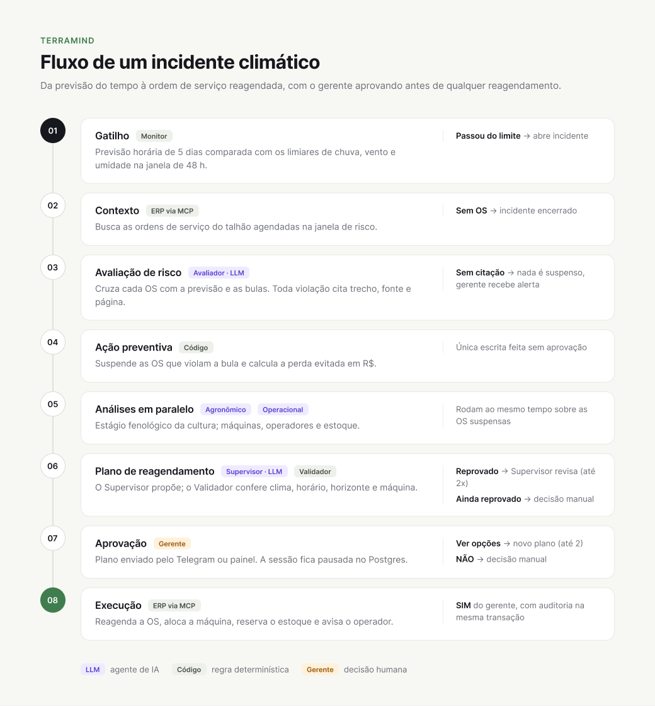

# TerraMind

Agente que protege operações agrícolas agendadas contra eventos climáticos extremos. Quando a previsão indica chuva, vento ou umidade fora do limite, o TerraMind encontra as ordens de serviço em risco, suspende o que a bula do produto não permite e monta um plano de reagendamento, que só é executado depois que o gerente aprova.

## Como funciona

```
Monitor (clima) ──incidente──→ agents (workflow) ──consulta──→ conhecimento (bulas)
                                    │    ▲
                         lê/escreve │    │ SIM / NÃO / Ver opções
                                    ▼    │
                            ERP via MCP   Telegram, WhatsApp ou painel (gerente)
```

<p align="center">
  
</p>

1. O `monitor` lê a previsão horária de 5 dias (Open-Meteo) e compara chuva acumulada, vento e umidade na janela de 48 h com os limiares. Se algum passar, abre um incidente com as 120 h da previsão e avisa o `agents`.
2. O workflow busca no ERP as OS agendadas do talhão que caem na janela de risco. Se não houver nenhuma, o incidente é encerrado.
3. O Avaliador (LLM) cruza cada OS com a previsão e consulta as bulas na base de conhecimento. Toda violação precisa citar o trecho, a fonte e a página. Sem citação, nada é suspenso e o gerente recebe um alerta.
4. As OS que violam a bula são suspensas (`agendada → suspensa_preventiva`). É a única escrita feita sem aprovação. A perda evitada em R$ é calculada em código, com fatores de perda documentados.
5. O Agronômico olha o estágio fenológico da cultura e o Operacional olha máquinas, operadores e estoque. Os dois analisam as OS suspensas ao mesmo tempo.
6. O Supervisor (LLM) propõe um reagendamento e o Validador (código) confere clima, horário, horizonte e máquina. Se o Validador reprovar, o Supervisor revisa até 2 vezes; se continuar reprovado, o caso vai para decisão manual.
7. O plano chega ao gerente pelo Telegram ou pelo WhatsApp (o da fazenda do incidente). O rodapé (perda, data, máquina, fonte e página) é montado a partir do estado, nunca do texto do LLM. Enquanto espera a resposta, a sessão fica pausada no Postgres e sobrevive a um restart.
8. Com SIM, o sistema reagenda a OS, aloca a máquina, reserva o estoque e avisa o operador. Ver opções gera um novo plano (até 2 vezes). NÃO manda o caso para decisão manual.

Valores em R$ só saem de código, um clique duplo não executa nada duas vezes e o ERP recusa qualquer reagendamento sem plano aprovado no banco. Toda escrita grava auditoria na mesma transação.

## Agentes

O workflow é um grafo do Google ADK. Quatro nós são agentes LLM e o resto é código: contexto, suspensão, janelas, cálculo de perda, validação e execução. Cada agente recebe o contexto numa instrução em JSON montada em código e não vê o histórico da sessão. Ele só sabe o que está na instrução e o que as ferramentas devolvem.

| Agente | Quando roda | Ferramentas | Saída |
|---|---|---|---|
| Avaliador de Risco | Depois do contexto, se há OS na janela | `buscar_trechos` | `AvaliacaoRisco`: por OS e limite violado, parâmetro, limite, janela em horas, valor previsto, trecho literal, fonte e página |
| Agronômico | Depois da suspensão, junto com o Operacional | `buscar_trechos`, `consultar_talhao` | Texto de até 6 frases, com fonte e página |
| Operacional | Depois da suspensão, junto com o Agronômico | `janelas_validas`, `listar_os`, `disponibilidade_maquinas`, `listar_operadores` | Texto de até 8 frases, com datas e ids |
| Supervisor | Depois das análises, e de novo quando o Validador reprova ou o gerente pede outras opções | `janelas_validas`, `calcular_impacto` | `PlanoProposto`: uma opção (novo início e máquina) por OS suspensa e a mensagem ao gerente |
| Pergunte à bula | Fora do incidente, quando alguém pergunta no painel (`/bula`), no Telegram ou no WhatsApp (qualquer mensagem de texto do gerente ou de um chat em `TELEGRAM_CHATS_BULA` / `WHATSAPP_NUMEROS_BULA`) ou em `POST /bula/perguntar` | `buscar_na_bula` | `RespostaBula`: resposta curta com trecho literal, fonte e página |

O Pergunte à bula tem a mesma garantia do Avaliador. O código confere que cada citação é literal de um trecho que a busca devolveu, com a mesma fonte e página. Sem citação conferida, a resposta é "A bula não traz isso." As 20 perguntas de teste estão em [agents/avaliacao/perguntas_bula.yaml](agents/avaliacao/perguntas_bula.yaml) e rodam contra o LLM e a base reais com `uv run python -m agents.avaliar_bula`.

O Avaliador de Risco procura na bula de cada produto os limites de chuva, vento, umidade e temperatura. Depois compara com a previsão no horário da OS, que já chega calculada em código: os extremos durante a aplicação e a chuva acumulada depois do fim. Ele só marca violação se o trecho trouxer o limite e a previsão passar dele. O schema exige o texto literal do trecho, a fonte e a página, e rejeita a saída que vier sem isso.

O Agronômico explica o que a chuva pode causar naquela cultura e naquele estágio: perda de produto, lixiviação, deriva, mudança na janela de aplicação. Para isso, busca os documentos de fenologia da Embrapa pela cultura e pelo nome do estágio (`estádio V6 do milho`) e cruza com o que a bula diz sobre época, intervalo de aplicação e intervalo de segurança.

O Operacional consulta as janelas válidas de cada OS suspensa e sugere quando remarcar e com qual máquina, de preferência a que já estava alocada. Também aponta conflitos com outras OS do mesmo talhão ou da mesma máquina.

O Supervisor junta as duas análises num plano. Ele só pode escolher datas e máquinas que `janelas_validas` devolveu. A mensagem ao gerente tem no máximo 5 linhas e não leva valores em R$ nem páginas, porque esses dados entram no rodapé, montado em código. Se o Validador reprova, o Supervisor recebe o motivo e corrige. Se o gerente pede outras opções, as datas já oferecidas saem da lista.

### O que fica em código

- Um início de janela só vale se for hora cheia entre 06h e 18h, estiver pelo menos 2 h à frente, couber nas 120 h da previsão e respeitar o limite citado pelo Avaliador durante o tempo em que ele se aplica. No caso da chuva, esse tempo é a aplicação mais as horas seguintes que a bula pede. Também precisa haver máquina livre do tipo certo no ERP.
- A perda evitada é `área × dose × preço × fator`. O fator vem da base de conhecimento, com página citada ou estimativa declarada. Se não houver fator, a perda fica em branco; o LLM não chuta um valor.
- O Validador reprova o plano quando falta opção para alguma OS suspensa, quando a data já foi oferecida ao gerente, quando a janela não passa no clima ou quando a máquina está ocupada, não existe ou é de outro tipo. Cada motivo volta para o Supervisor.
- Antes de gravar, o Executor confere a janela de novo. Se ela deixou de valer, o fluxo volta para um novo plano.
- Além da chuva, as janelas tratam vento (máximo e mínimo), umidade, temperatura, rajada, Delta T e inversão térmica. Os três últimos vêm dos campos opcionais do Monitor (contrato 21). Sem o dado, a janela não é aceita.
- Custo da demora: ao propor o plano, o código grava quando a janela proposta vence e quanto custa perdê-la: `valor da aplicação × fator de atraso por dia × dias até a próxima janela boa`. O lembrete do timeout e o painel mostram esses números. O fator vem do conhecimento (`condicao=atraso`) ou, até o E7, da estimativa declarada em `FATOR_ATRASO_DIA`. Se o Avaliador falhou e a OS não foi suspensa, a decisão manual mostra a perda inteira de aplicar com o tempo previsto.

### Fora do incidente: perda evitada, agenda, janela da OS e relatório

Quatro recursos rodam sem incidente aberto. Nenhum deles põe número ou data vindo de LLM na tela.

- **Perda evitada (`/perda`, G1).** A Ação Preventiva grava uma linha por OS suspensa em `agente.impactos` (contrato 25), com valor da aplicação, fator, fonte e perda. O Executor muda a situação para `evitada` quando o plano é executado; recusa e decisão manual também ficam registradas. A tela soma só o que foi evitado, por talhão e por produto, e mostra planos aprovados, recusados e sem resposta e o tempo médio até a resposta. Incidente de replay (`origem = 'replay'`, contrato 27) fica de fora, a não ser com "Incluir simulações". Com `PRECO_HA_SAFRA` definido, a tela mostra quantas vezes a perda evitada paga a assinatura.
- **Agenda (`/agenda`, G2).** `GET /agenda?insumo_id=` devolve, por talhão e por dia, as horas boas e ruins para começar a aplicação, com o motivo. Os limites vêm de `conhecimento.limites_produto` (contrato 26). O botão "Ler os limites da bula" chama `POST /limites/extrair`: um agente lê a bula uma vez, e o código só aceita o limite cujo trecho veio da busca, com a mesma página, e cujo número aparece no trecho. Para o parâmetro que a bula não traz, vale uma referência genérica (vento de 3 a 10 km/h, até 30 °C, umidade a partir de 55%, Delta T de 2 a 10 °C), sempre marcada como genérica.
- **Janela da OS (G3).** `POST /janelas/avaliar` diz se a janela serve. Se não serve, devolve o motivo com a página da bula e até 3 janelas boas com máquina livre. No formulário "Agendar aplicação", aceitar uma sugestão preenche o campo, e a OS só é criada com a janela conferida.
- **Relatório de aplicação (`/relatorios`, G7).** Concluir a OS grava os dados reais (`erp.execucoes_os`, contrato 28) e gera um PDF com área, produto, dose, execução, clima durante a aplicação e a conferência de cada limite da bula, com a página. O SHA-256 dos dados vai no rodapé e fica no banco. O que a norma pede para drone, avião e aplicação terrestre, e o que ainda falta, está em [docs/relatorio-de-aplicacao.md](docs/relatorio-de-aplicacao.md).

A previsão desses recursos vem direto do Open-Meteo (`agents/clientes/clima.py`), com direção e rajada do vento, o Delta T calculado da temperatura e da umidade e a inversão térmica (ar a 80 m pelo menos 0,5 °C mais quente que a 2 m, com vento abaixo de 6 km/h). Na bula, chuva "zero" aceita até 1 mm no período: o modelo põe garoa de 0,1 mm em quase toda hora. Em todo o sistema, inclusive no Monitor, o vento e a rajada são os da altura da barra (2 m), convertidos dos 10 m do Open-Meteo pela FAO-56 (× 0,748), porque é assim que a bula e o anemômetro do operador medem. O incidente continua usando o snapshot do Monitor. Quando o Monitor expuser a previsão por talhão (contrato 19), basta trocar a implementação do cliente.

### Quando um agente falha

Cada agente pode fazer até 6 rodadas de chamadas de ferramenta, e na última só pode responder. Se uma ferramenta dá erro, o modelo recebe `{"ok": false}` e segue. Se o próprio modelo falha, estoura o timeout (90 s, com 2 tentativas) ou devolve algo fora do schema, a saída vira vazia e o fluxo segue por um caminho seguro:

- Se o Avaliador falha, nada é suspenso, a OS continua agendada e o gerente recebe um alerta.
- Se o Agronômico ou o Operacional falha, a análise dele vira "(análise indisponível)" e o Supervisor trabalha com a outra.
- Se o Supervisor falha, o plano sai vazio, o Validador reprova e, depois de 2 voltas, o caso vai para decisão manual.

Os modelos ficam nas variáveis `MODEL_AVALIADOR`, `MODEL_AGRONOMICO`, `MODEL_OPERACIONAL` e `MODEL_SUPERVISOR`. Para testar um agente sozinho, sem Postgres, MCP ou Telegram, rode `uv run adk web agents/agentes` (detalhes em [agents/README.md](agents/README.md)).

## Serviços

| Serviço | Porta | Papel |
|---|---|---|
| `monitor` | 8020 | Compara a previsão com os limiares e abre incidentes |
| `agents` | 8000 | Workflow do incidente (Google ADK) e canal de aprovação |
| `conhecimento` | 8010 | Trechos das bulas no Qdrant e fatores de perda |
| `erp-mcp` | 8030 | Servidor MCP sobre o mini-ERP (talhões, OS, máquinas, estoque) |
| `painel` | 8080 | Ordens de serviço ao vivo, linha do tempo, "Simular chuva", agenda, perda evitada e relatórios de aplicação |
| `postgres`, `qdrant` | 5432, 6333 | ERP, estado dos agentes e base vetorial |

## Executar

```bash
cp .env.example .env          # preencha OPENAI_API_KEY (e o Telegram, se usar CHANNEL=telegram)
docker compose up -d --build
```

Abra `http://localhost:8080` e clique em Simular chuva para disparar o cenário de 80 mm.

### Migrations

O serviço `migrar` roda a cada `docker compose up` e aplica só as migrations novas de `db/migrations/`,
registrando as aplicadas em `public.migracoes_aplicadas`. Cadastros e incidentes não são apagados:
`docker compose down -v` só é preciso para recomeçar a demo do zero (as datas do seed contam a partir da
criação do banco).

```bash
docker compose run --rm migrar                # aplica o que falta (também roda sozinho na subida)
docker compose run --rm migrar python -m db.migrar --listar   # aplicadas e pendentes
```

Banco criado antes do runner (sem a tabela de registro) é adotado sozinho: o que já estava lá é só
registrado e o que faltava (ex.: `003_fazendas.sql`, `020_decisao.sql`) é aplicado. Migration já aplicada
não se edita: a correção vai numa migration nova. Faixas: Felipe `003`–`009` e seed `9xx`, Edison
`011`–`019`, Gustavo `020`–`029`.

### Fazendas

Organização > fazenda > talhões, máquinas, operadores, insumos e OS (`fazenda_id` em todos). O seed traz
a "Fazenda Exemplo" e a "Fazenda Demo" (organizações diferentes; a Demo é onde o replay roda). Cada
fazenda tem seus gerentes em `erp.gerentes`: o canal manda cada mensagem ao gerente da fazenda do
incidente. `GERENTE_CHAT_ID` é só o gerente padrão, para a fazenda sem gerente com chat. O painel filtra
tudo pela fazenda escolhida no menu (cookie `fazenda`).

### Canais

`CHANNEL=painel` (padrão, sem token), `telegram` ou `whatsapp`. O WhatsApp recebe a resposta por webhook
público (Twilio) e, fora da janela de 24 h, só manda modelo aprovado: ver [docs/whatsapp.md](docs/whatsapp.md).

Mais detalhes: [agents/README.md](agents/README.md) · [docs/contratos.md](docs/contratos.md) · [docs/plans/](docs/plans/)
