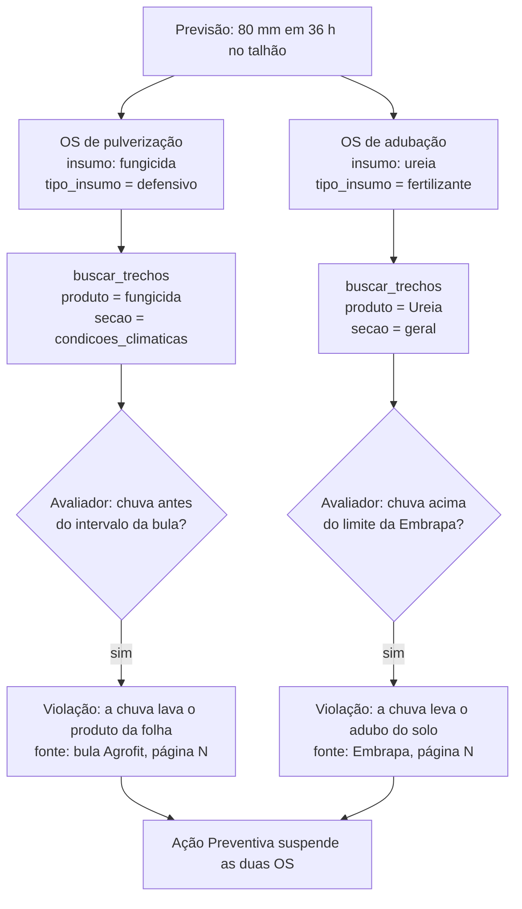
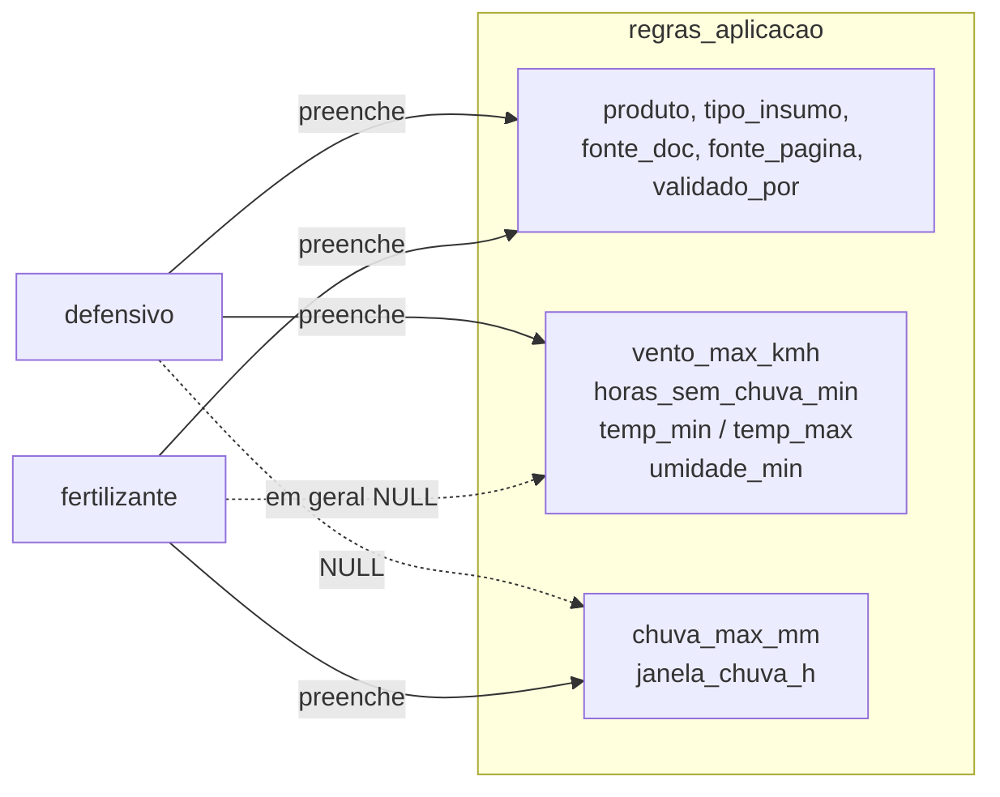
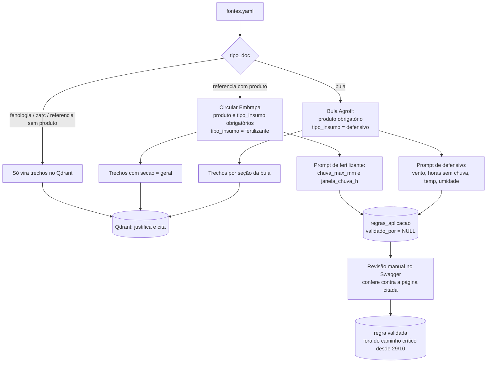
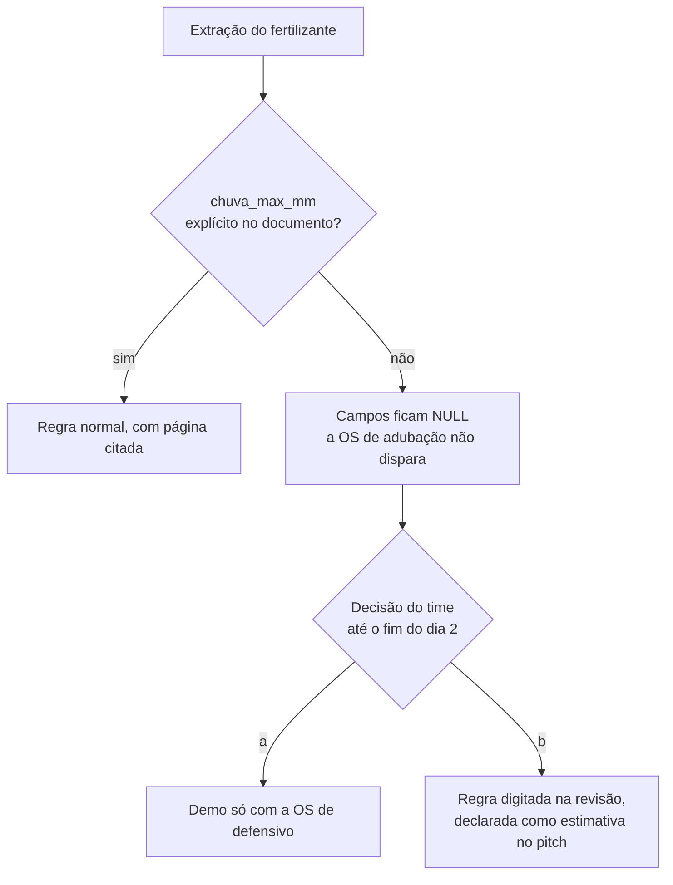
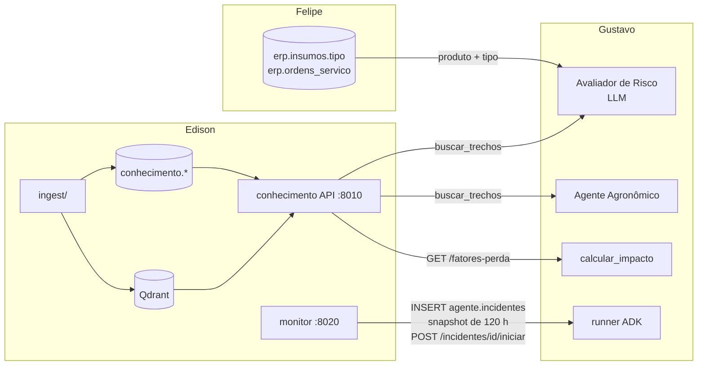

# TerraMind · Conhecimento e Clima (frente do Edison) — Implementation Plan

> **For agentic workers:** REQUIRED SUB-SKILL: Use superpowers:subagent-driven-development (recommended) or superpowers:executing-plans to implement this plan task-by-task. Steps use checkbox (`- [ ]`) syntax for tracking.

**Goal:** Entregar a base de conhecimento (documentos → Qdrant + regras validadas no Postgres) para **dois tipos de insumo**, defensivos (bulas do Agrofit) e fertilizantes (referências técnicas da Embrapa), as ferramentas `consultar_regras` e `buscar_trechos` para os agentes, e o Monitor de clima (Open-Meteo + replay) que abre incidentes.

**Architecture:** Dois serviços FastAPI e um pipeline offline. `conhecimento/` é biblioteca + API (trechos, fatores de perda, regras, revisão manual). `ingest/` é a CLI offline que lê os PDFs e grava no Qdrant e no Postgres, importando a biblioteca `conhecimento`. `monitor/` é uma API FastAPI com um loop em background: compara a previsão com os limiares, grava em `agente.incidentes` e avisa o runner do ADK por HTTP. **Desde 29/10, o Avaliador de Risco do Gustavo é um LLM que decide a violação a partir dos trechos do Qdrant (`buscar_trechos`) e cita fonte e página** (decisão A4 em [docs/contratos.md](../contratos.md)). Os trechos e seus metadados passaram a decidir; a tabela `regras_aplicacao` continua no schema, mas fica fora do caminho crítico.

> **Revisado em 29/10/2026** com as decisões da frente de agentes. O que mudou: prioridade das fases (a Fase 3 fica opcional, exceto a Task 10), contratos 3, 4, 7 e 8, Task 11 e Task 15, trabalho de dados. A numeração de contratos abaixo é a deste plano; a numeração do time está em `docs/contratos.md`.

**Tech Stack:** Python 3.12, uv, FastAPI, Pydantic v2 + pydantic-settings, SQLAlchemy 2 (Core, síncrono) + psycopg 3, qdrant-client, fastembed, PyMuPDF, LiteLLM, httpx, pytest, respx, testcontainers, ruff.

**Spec:** "Arquitetura para desenvolvimento" (27/10/2026), https://claude.ai/artifact/LPREo4b1mJytK1XCKEnMsL. Seções usadas: Base de conhecimento, Modelo de dados (schema `conhecimento`), Fluxo do agente (etapa 1), Repositório e containers, Plano de 7 dias, Riscos.

## Global Constraints

- Linha de `regras_aplicacao` ou `tolerancia_fenologica` sem `validado_por` nunca sai da API nem das ferramentas.
- Parâmetro que a bula não traz explicitamente fica `NULL`, sem valor inferido nem default.
- O Avaliador de Risco (LLM, frente do Gustavo) decide a partir dos trechos do Qdrant e cita `fonte_doc` + `pagina`. Por isso todo trecho precisa de `produto` (quando o documento é de um produto), `secao` e `pagina` corretos: um metadado errado vira uma decisão errada.
- Unidades fixas: vento em km/h, temperatura em °C, umidade em %, chuva em mm, tempo em horas.
- Fuso: `America/Sao_Paulo`. Todo `datetime` é *timezone-aware*.
- Variáveis: `MODEL_EXTRACAO` (só do `ingest`, formato OpenRouter `openrouter/<org>/<modelo>` com `OPENROUTER_API_KEY`; usada apenas se a Fase 3 for feita), `MONITOR_MODE` (`live` | `replay`), `DATABASE_URL`, `QDRANT_URL`, `EMBEDDING_MODEL`, `AGENTS_URL`, `CONHECIMENTO_URL`.
- Fator de perda: tem fonte citada ou é declarado como estimativa.
- Um trecho (chunk) nunca atravessa páginas, para a citação de página ser exata.
- `tipo_insumo` ∈ {`defensivo`, `fertilizante`}, com os mesmos valores em `erp.insumos.tipo`, `conhecimento.regras_aplicacao.tipo_insumo` e `conhecimento.fatores_perda.tipo_insumo`.
- `chuva_max_mm` e `janela_chuva_h` andam juntos: ou os dois têm valor, ou os dois são `NULL`.
- O LLM nunca inventa limiar. Se o documento do fertilizante não traz um número de chuva, a regra fica `NULL` (ver contrato 8).
- Commits em Conventional Commits, em português e no imperativo: `tipo(escopo): descrição`. Escopos: `conhecimento`, `ingest`, `monitor`, `tools`, `db`, `infra`, `docs`.

## Contratos a fechar com o time no dia 1

Estes pontos tocam o código do Gustavo ou do Felipe. O plano assume a proposta abaixo; se o time decidir diferente, ajuste só o Interfaces da tarefa indicada.

| # | Contrato | Proposta | Com quem | Tarefa |
|---|---|---|---|---|
| 1 | Identificação do produto | `erp.insumos.produto` = `regras_aplicacao.produto`; `erp.insumos.bula_id` = `conhecimento.documentos.id` (para fertilizante, aponta para a referência da Embrapa); `erp.insumos.tipo` ∈ {`defensivo`, `fertilizante`} | Felipe | 2 |
| 2 | Containers novos | `conhecimento` e `monitor` viram containers próprios (na spec, o Monitor rodava dentro de `agents`) | Felipe, Gustavo | 17 |
| 3 | Abertura de incidente | **Fechado com o Gustavo (29/10).** Monitor faz INSERT em `agente.incidentes` com `status = 'aberto'` e chama `POST {AGENTS_URL}/incidentes/{id}/iniciar` (202, idempotente). `previsao_snapshot` guarda **todas as horas** da previsão (5 dias), não só a janela de risco, porque o `janelas_validas` do Gustavo procura a próxima janela nela. "Aberto" = `status <> 'encerrado'`; estados possíveis: `aberto`, `aguardando_aprovacao`, `aguardando_decisao_manual`, `encerrado`, e só `agents` muda o status depois da criação | Gustavo | 15 |
| 4 | Ferramentas ADK | **Fechado com o Gustavo (29/10).** `buscar_trechos` está no caminho crítico (o Avaliador decide com ela); `consultar_regras` continua existindo, mas nenhum nó depende dela. Assinaturas na Task 11 | Gustavo | 11 |
| 5 | Migrations | Arquivos SQL numerados em `db/migrations/`; o meu é `010_conhecimento.sql` | Felipe | 2 |
| 6 | Fonte para adubação | **Decidido (29/10):** trabalhar com os dois. Defensivo usa bula do Agrofit (`tipo_doc = "bula"`); fertilizante usa referência técnica da Embrapa (`tipo_doc = "referencia"` com `produto` preenchido) | Time | 2, 4, 8 |
| 7 | Regra de chuva do fertilizante | Campos `chuva_max_mm` e `janela_chuva_h` em `regras_aplicacao` continuam no schema. **Desde 29/10, o Avaliador não lê a tabela:** ele lê o trecho da referência da Embrapa e decide. O que importa para a demo é o trecho com o limite de chuva estar indexado com `produto` preenchido | Gustavo | 2, 5 |
| 8 | Plano B: limiar sem número no documento | Se nenhuma referência da Embrapa trouxer um limite em mm, o Avaliador não terá violação citável: a OS de adubação não é suspensa e o gerente só recebe um alerta. O time decide até o fim do dia 2 se (a) a OS de fertilizante sai da demo, ficando só a de defensivo, ou (b) troca de documento | Time | dados, dia 2 |
| 9 | Condição do fator de perda | `condicao` = tipo do gatilho do monitor: `chuva` · `vento` · `umidade` · `temperatura`. O `calcular_impacto` do Gustavo busca `GET /fatores-perda?tipo_insumo=&condicao=` com esses valores | Gustavo | 3, 10 |

## Review Focus

1. **Rodar o ingest duas vezes** não pode duplicar pontos no Qdrant nem apagar regras já validadas → testes na Task 6 e na Task 8.
2. **Open-Meteo fora do ar ou lento** no modo `live`: o Monitor registra o erro, segue para o próximo talhão e não cai → teste na Task 15.
3. **O Monitor abre o mesmo incidente a cada ciclo** enquanto a chuva segue prevista → teste de deduplicação na Task 15.
4. **Cenário de replay gravado em data passada** não dispararia nada no dia da demo → o rebase para "agora" tem teste na Task 13.
5. **O LLM cita uma página que não existe ou devolve vento em m/s** → página validada contra o PDF e faixas no Pydantic, com testes na Task 8.
6. **Regra de fertilizante com só metade do par** (`chuva_max_mm` sem `janela_chuva_h`) → `CHECK` na migration e validador no Pydantic, com testes nas Tasks 2, 8 e 9.
7. **Trecho certo para o Avaliador:** para cada produto da demo, `buscar_trechos("chuva após aplicação", produto=...)` devolve, entre os 3 primeiros, o trecho que contém o limite, com a página certa → teste de aceitação com os PDFs reais na Task 7 (dia 2).
8. **Snapshot completo:** o incidente guarda as 120 h devolvidas pela fonte, não só a janela de risco → teste na Task 15.

---

## Conceitos novos em fluxogramas

### 1. Um evento de chuva, dois riscos

A mesma previsão de 80 mm afeta as duas ordens de serviço por motivos diferentes. Desde 29/10, quem decide é o Avaliador (LLM) do Gustavo, lendo o trecho de cada documento; o que esta frente garante é que o trecho certo chegue a ele.



### 2. Que colunas cada tipo preenche

Uma tabela só. Coluna `NULL` = regra não avaliada.



### 3. Do documento à regra validada

O caminho de cada documento no pipeline. O que muda entre os dois tipos é só o prompt de extração.



### 4. Plano B se o documento do fertilizante não trouxer número (contrato 8)



### 5. Onde a frente se liga às outras



---

## Mapa de arquivos

```
conhecimento/                      # serviço FastAPI + biblioteca compartilhada
├── pyproject.toml
├── Dockerfile
├── conhecimento/
│   ├── config.py                  # Settings (pydantic-settings)
│   ├── db.py                      # criar_engine(url)
│   ├── modelos.py                 # Pydantic: TipoInsumo, RegraAplicacao, ToleranciaFenologica, FatorPerda, Trecho, TrechoEncontrado
│   ├── repositorio.py             # RepositorioConhecimento (SQL)
│   ├── embeddings.py              # Embedder, FastEmbedEmbedder, EmbedderDeterministico
│   ├── qdrant.py                  # garantir_colecao, indexar
│   ├── busca.py                   # buscar(...)
│   └── api/
│       ├── main.py                # app, /health, dependências
│       ├── regras.py              # /regras, /tolerancias, /fatores-perda
│       ├── trechos.py             # /trechos/busca
│       └── revisao.py             # /revisao/...
└── tests/
ingest/                            # CLI offline
├── pyproject.toml                 # depende de conhecimento (path, editable)
├── ingest/
│   ├── __main__.py                # typer: indexar | extrair-regras | carregar-fatores
│   ├── manifesto.py               # Fonte, carregar_manifesto
│   ├── pdf.py                     # PaginaTexto, extrair_paginas
│   ├── chunking.py                # dividir_em_trechos
│   ├── extracao.py                # LlmJson, LiteLlmJson, extrair_regra, extrair_tolerancias
│   └── fatores.py                 # carregar_fatores
├── data/
│   ├── fontes.yaml                # manifesto dos documentos
│   ├── fatores_perda.yaml
│   └── docs/*.pdf                 # bulas, referências Embrapa de adubação, manuais de fenologia, ZARC
└── tests/
monitor/                           # serviço FastAPI + loop
├── pyproject.toml
├── Dockerfile
├── monitor/
│   ├── config.py
│   ├── modelos.py                 # HoraPrevisao, Talhao, Gatilho, Limiares, ResultadoCiclo
│   ├── fontes.py                  # FontePrevisao, OpenMeteoFonte, ReplayFonte
│   ├── avaliacao.py               # avaliar(...)
│   ├── repositorio.py             # RepositorioMonitor
│   ├── notificador.py             # Notificador, NotificadorHttp
│   ├── ciclo.py                   # executar_ciclo(...)
│   ├── gravar.py                  # CLI que grava um cenário real
│   └── api.py                     # app, lifespan com loop, /status, /replay, /ciclo
├── scenarios/chuva_80mm.json
└── tests/
agents/tools/conhecimento.py       # ferramentas ADK (PR para o Gustavo)
db/migrations/010_conhecimento.sql
db/seeds/conhecimento_fake.sql     # regras fake para o dia 3
```

Testes de cada serviço: `cd <serviço> && uv run pytest -v`. Testes com Postgres usam `testcontainers` (`postgres:16`) e aplicam os SQL de `db/migrations/` em ordem. Enquanto as migrations do Felipe não existirem, o monitor usa `monitor/tests/sql/contrato_minimo.sql` com `erp.talhoes(id, nome, lat, lon)` e `agente.incidentes(id, talhao_id, gatilho jsonb, previsao_snapshot jsonb, status, criado_em)`.

---

## Fase 1 — Base do serviço de conhecimento (branch `feat/conhecimento-base`, dia 1)

### Task 1: Esqueleto do serviço `conhecimento`

**Files:**
- Create: `conhecimento/pyproject.toml`, `conhecimento/conhecimento/config.py`, `conhecimento/conhecimento/api/main.py`, `conhecimento/tests/test_health.py`, `.gitignore`, `ruff.toml` (raiz, se ainda não existir)

**Interfaces:**
- Produces: `Settings` com `database_url: str`, `qdrant_url: str`, `embedding_model: str = "sentence-transformers/paraphrase-multilingual-MiniLM-L12-v2"`, `colecao_qdrant: str = "trechos"`; `app: FastAPI` em `conhecimento.api.main`.

- [ ] **Step 1: Teste que falha**

```python
def test_health(client):
    r = client.get("/health")
    assert r.status_code == 200
    assert r.json() == {"status": "ok"}
```

- [ ] **Step 2:** `uv run pytest tests/test_health.py -v` → FAIL (módulo inexistente)
- [ ] **Step 3:** Criar o projeto com `uv init --package`, adicionar dependências (fastapi, uvicorn[standard], pydantic-settings, sqlalchemy, psycopg[binary], qdrant-client, fastembed; dev: pytest, httpx, respx, testcontainers[postgres], ruff), `Settings` e `GET /health`.
- [ ] **Step 4:** `uv run pytest -v && uv run ruff check .` → PASS
- [ ] **Step 5:** `git commit -m "feat(conhecimento): cria serviço FastAPI com health check"`

### Task 2: Schema `conhecimento`, repositório e seed fake

**Files:**
- Create: `db/migrations/010_conhecimento.sql`, `db/seeds/conhecimento_fake.sql`, `conhecimento/conhecimento/db.py`, `conhecimento/conhecimento/modelos.py`, `conhecimento/conhecimento/repositorio.py`, `conhecimento/tests/conftest.py`, `conhecimento/tests/test_repositorio.py`

**Interfaces:**
- Produces:
  - Tabelas em `conhecimento.`:
    - `documentos(id text PK, titulo, tipo_doc CHECK IN ('bula','fenologia','zarc','referencia'), produto NULL, culturas text[], url, arquivo)`.
    - `paginas(doc_id FK, pagina int, texto, PK(doc_id, pagina))`.
    - `regras_aplicacao(id serial, produto, tipo_insumo text NOT NULL CHECK IN ('defensivo','fertilizante'), vento_max_kmh, horas_sem_chuva_min, temp_min, temp_max, umidade_min, chuva_max_mm, janela_chuva_h, fonte_doc FK, fonte_pagina int NOT NULL, validado_por NULL, validado_em NULL, criado_em)`, com:
      - índice único parcial em `produto WHERE validado_por IS NOT NULL`;
      - `CHECK ((chuva_max_mm IS NULL) = (janela_chuva_h IS NULL))`, para o par andar junto.
    - `tolerancia_fenologica(id, cultura, estagio, tolerancia_encharcamento, tolerancia_deficit_hidrico CHECK IN ('baixa','media','alta') NULL, fonte_doc, fonte_pagina, validado_por, validado_em)`, com índice único parcial em `(cultura, estagio)` validados.
    - `fatores_perda(id, tipo_insumo CHECK IN ('defensivo','fertilizante'), condicao, fator numeric CHECK 0..1, fonte_ou_estimativa text NOT NULL, UNIQUE(tipo_insumo, condicao))`.
  - `TipoInsumo = Literal["defensivo", "fertilizante"]`.
  - Modelos Pydantic `RegraAplicacao`, `ToleranciaFenologica`, `FatorPerda`, com os campos das tabelas e campos numéricos `float | None`. `RegraAplicacao` tem um `model_validator` que exige `chuva_max_mm` e `janela_chuva_h` juntos.
  - `RepositorioConhecimento(engine)` com `regra_validada(produto: str) -> RegraAplicacao | None`, `tolerancia_validada(cultura: str, estagio: str) -> ToleranciaFenologica | None` e `fator_perda(tipo_insumo: str, condicao: str) -> FatorPerda | None`.
  - O seed fake cria o documento `fake-seed` e uma regra validada com `validado_por = 'seed-fake'` para cada produto do seed do Felipe (contrato 1). Pelo menos um produto de cada tipo: o defensivo com `horas_sem_chuva_min` e o fertilizante com `chuva_max_mm` e `janela_chuva_h`. Serve para o fluxo de ponta a ponta do dia 3.

- [ ] **Step 1: Testes que falham** (fixture `engine` com testcontainers, aplicando a migration)

```python
def test_regra_pendente_nao_e_retornada(repo, inserir_regra):
    inserir_regra(produto="Ureia", validado_por=None)
    assert repo.regra_validada("Ureia") is None

def test_parametro_ausente_volta_none(repo, inserir_regra):
    inserir_regra(produto="Ureia", horas_sem_chuva_min=None, validado_por="edison")
    regra = repo.regra_validada("Ureia")
    assert regra is not None and regra.horas_sem_chuva_min is None

def test_seed_fake_carrega(repo, aplicar_seed_fake):
    regras = aplicar_seed_fake()
    assert all(r.validado_por == "seed-fake" for r in regras)
    assert {r.tipo_insumo for r in regras} == {"defensivo", "fertilizante"}

def test_regra_de_fertilizante(repo, inserir_regra):
    inserir_regra(produto="Ureia", tipo_insumo="fertilizante", chuva_max_mm=30, janela_chuva_h=24, validado_por="edison")
    regra = repo.regra_validada("Ureia")
    assert regra.chuva_max_mm == 30 and regra.vento_max_kmh is None

def test_chuva_sem_janela_rejeitada(inserir_regra):
    with pytest.raises(IntegrityError):
        inserir_regra(produto="Ureia", tipo_insumo="fertilizante", chuva_max_mm=30, janela_chuva_h=None)
```

- [ ] **Step 2:** `uv run pytest tests/test_repositorio.py -v` → FAIL
- [ ] **Step 3:** Escrever a migration, o seed, `criar_engine`, os modelos e o repositório, com SQL explícito via `sqlalchemy.text`.
- [ ] **Step 4:** `uv run pytest -v` → PASS
- [ ] **Step 5:** `git commit -m "feat(db): adiciona schema conhecimento e seed de regras fake"` (migration + seed) e depois `git commit -m "feat(conhecimento): adiciona repositório de regras validadas"`

### Task 3: API de leitura de regras, tolerâncias e fatores

**Files:**
- Create: `conhecimento/conhecimento/api/regras.py`, `conhecimento/tests/test_api_regras.py`
- Modify: `conhecimento/conhecimento/api/main.py` (dependência `get_repo`, incluir router)

**Interfaces:**
- Consumes: `RepositorioConhecimento` (Task 2).
- Produces:
  - `GET /regras/{produto}` → `RegraAplicacao` ou 404 `{"detail": "regra_nao_validada"}`.
  - `GET /tolerancias/{cultura}/{estagio}` → `ToleranciaFenologica` ou 404.
  - `GET /fatores-perda?tipo_insumo=&condicao=` → `FatorPerda` ou 404.

- [ ] **Step 1: Testes que falham** (repositório falso via `app.dependency_overrides`; não precisam de Postgres)

```python
def test_regra_validada(client_com_repo):
    r = client_com_repo(regras={"Ureia": regra_exemplo()}).get("/regras/Ureia")
    assert r.status_code == 200
    assert r.json()["fonte_pagina"] == 3 and r.json()["fonte_doc"] == "bula-ureia"

def test_regra_inexistente_404(client_com_repo):
    r = client_com_repo(regras={}).get("/regras/Ureia")
    assert r.status_code == 404 and r.json()["detail"] == "regra_nao_validada"
```

Teste equivalente para `/tolerancias/soja/R1` e `/fatores-perda`, e um teste que confere `tipo_insumo`, `chuva_max_mm` e `janela_chuva_h` no JSON de uma regra de fertilizante.

- [ ] **Step 2:** `uv run pytest tests/test_api_regras.py -v` → FAIL
- [ ] **Step 3:** Implementar o router.
- [ ] **Step 4:** `uv run pytest -v` → PASS
- [ ] **Step 5:** `git commit -m "feat(conhecimento): expõe regras, tolerâncias e fatores de perda"`

**Fim da fase:** PR `feat/conhecimento-base` → revisão do Gustavo. Com isso, ele já consome `GET /fatores-perda` via API; as regras fake só servem se a Fase 3 for feita.

---

## Fase 2 — Ingestão e Qdrant (branch `feat/ingest-qdrant`, dia 2)

### Task 4: Manifesto de fontes e extração de PDF por página

**Files:**
- Create: `ingest/pyproject.toml` (dependências: `conhecimento` via `[tool.uv.sources] conhecimento = { path = "../conhecimento", editable = true }`, pymupdf, pyyaml, typer, litellm), `ingest/ingest/manifesto.py`, `ingest/ingest/pdf.py`, `ingest/data/fontes.yaml` (vazio com um exemplo comentado), `ingest/tests/test_manifesto.py`, `ingest/tests/test_pdf.py`

**Interfaces:**
- Produces:
  - `Fonte(BaseModel)`: `id: str`, `titulo: str`, `tipo_doc: Literal["bula","fenologia","zarc","referencia"]`, `produto: str | None`, `tipo_insumo: TipoInsumo | None`, `culturas: list[str]`, `arquivo: Path`, `url: str`. Validação (`model_validator`):
    - `bula` → `produto` obrigatório e `tipo_insumo == "defensivo"`;
    - `referencia` com `produto` → `tipo_insumo` obrigatório (na prática, `fertilizante`);
    - `fenologia` e `zarc` → `produto` e `tipo_insumo` nulos;
    - `gera_regra` (propriedade) é `True` quando `produto` não é nulo.
  - `carregar_manifesto(caminho: Path) -> list[Fonte]`. `arquivo` é relativo a `ingest/data/`.
  - `PaginaTexto(pagina: int, texto: str)`, com páginas numeradas a partir de 1.
  - `extrair_paginas(pdf: Path) -> list[PaginaTexto]`.

- [ ] **Step 1: Testes que falham** (o PDF de teste é gerado com PyMuPDF em `tmp_path`)

```python
def test_extrai_paginas_numeradas(pdf_duas_paginas):
    paginas = extrair_paginas(pdf_duas_paginas)
    assert [p.pagina for p in paginas] == [1, 2]
    assert "CONDIÇÕES CLIMÁTICAS" in paginas[0].texto

def test_bula_sem_produto_invalida(tmp_path):
    with pytest.raises(ValidationError):
        carregar_manifesto(yaml_com(tipo_doc="bula", produto=None))

def test_referencia_de_fertilizante_gera_regra(tmp_path):
    [fonte] = carregar_manifesto(yaml_com(tipo_doc="referencia", produto="Ureia", tipo_insumo="fertilizante"))
    assert fonte.gera_regra is True

def test_referencia_com_produto_sem_tipo_invalida(tmp_path):
    with pytest.raises(ValidationError):
        carregar_manifesto(yaml_com(tipo_doc="referencia", produto="Ureia", tipo_insumo=None))
```

- [ ] **Step 2:** `cd ingest && uv run pytest -v` → FAIL
- [ ] **Step 3:** Implementar com `pymupdf.open(...)` e `page.get_text("text")`.
- [ ] **Step 4:** `uv run pytest -v` → PASS
- [ ] **Step 5:** `git commit -m "feat(ingest): lê manifesto de fontes e extrai texto por página"`

### Task 5: Chunking por seção da bula

**Files:**
- Create: `ingest/ingest/chunking.py`, `ingest/tests/test_chunking.py`
- Modify: `conhecimento/conhecimento/modelos.py` (adicionar `Trecho`)

**Interfaces:**
- Produces:
  - `Trecho(BaseModel)`: `doc_id`, `produto: str | None`, `tipo_doc`, `culturas: list[str]`, `pagina: int`, `secao: Literal["condicoes_climaticas","modo_aplicacao","intervalo_seguranca","outra","geral"]`, `ordem: int`, `texto: str`.
  - `dividir_em_trechos(fonte: Fonte, paginas: list[PaginaTexto], max_chars: int = 1200) -> list[Trecho]`.

Regras de corte:
- Cabeçalhos são reconhecidos sem diferenciar maiúsculas nem acentos:
  - "CONDIÇÕES CLIMÁTICAS" ou "CONDIÇÕES DE APLICAÇÃO" → `condicoes_climaticas`;
  - "MODO DE APLICAÇÃO" → `modo_aplicacao`;
  - "INTERVALO DE SEGURANÇA" → `intervalo_seguranca`.
- A seção vale até o próximo cabeçalho, inclusive na página seguinte.
- O corte é por parágrafo, até `max_chars`, sem atravessar página.
- Documentos que não são bula usam `secao="geral"`. Isso inclui as referências de fertilizante, que mantêm `produto` no payload para o filtro do `buscar_trechos` funcionar.

- [ ] **Step 1: Testes que falham**

```python
def test_secao_continua_na_pagina_seguinte(fonte_bula):
    paginas = [PaginaTexto(pagina=1, texto="CONDIÇÕES CLIMÁTICAS\nVento até 10 km/h."),
               PaginaTexto(pagina=2, texto="Não aplicar com chuva prevista em 4 horas.")]
    trechos = dividir_em_trechos(fonte_bula, paginas)
    assert trechos[-1].pagina == 2 and trechos[-1].secao == "condicoes_climaticas"

def test_trecho_respeita_tamanho_e_pagina(fonte_bula):
    trechos = dividir_em_trechos(fonte_bula, [PaginaTexto(pagina=1, texto="\n\n".join(["x" * 500] * 6))])
    assert all(len(t.texto) <= 1200 and t.pagina == 1 for t in trechos)

def test_documento_nao_bula_usa_geral(fonte_fenologia, paginas_simples):
    assert {t.secao for t in dividir_em_trechos(fonte_fenologia, paginas_simples)} == {"geral"}

def test_referencia_fertilizante_mantem_produto(fonte_embrapa_ureia, paginas_simples):
    trechos = dividir_em_trechos(fonte_embrapa_ureia, paginas_simples)
    assert {(t.secao, t.produto) for t in trechos} == {("geral", "Ureia")}
```

- [ ] **Step 2:** `uv run pytest tests/test_chunking.py -v` → FAIL
- [ ] **Step 3:** Implementar, normalizando acentos com `unicodedata` para casar os cabeçalhos.
- [ ] **Step 4:** `uv run pytest -v` → PASS
- [ ] **Step 5:** `git commit -m "feat(ingest): divide bulas em trechos por seção sem cruzar páginas"`

### Task 6: Embeddings, indexação idempotente e comando `indexar`

**Files:**
- Create: `conhecimento/conhecimento/embeddings.py`, `conhecimento/conhecimento/qdrant.py`, `conhecimento/tests/test_qdrant.py`, `ingest/ingest/__main__.py`, `ingest/tests/test_cli_indexar.py`
- Modify: `conhecimento/conhecimento/repositorio.py` (`upsert_documento(fonte_dict)`, `salvar_paginas(doc_id, paginas)`)

**Interfaces:**
- Produces:
  - `class Embedder(Protocol)`: `dimensao: int` e `embed(textos: list[str]) -> list[list[float]]`.
  - `FastEmbedEmbedder(model_name: str)` para produção e `EmbedderDeterministico(dimensao: int = 32)`, baseado em hash, para testes e desenvolvimento offline.
  - `garantir_colecao(client: QdrantClient, nome: str, dimensao: int) -> None`: distância cosseno e índices de payload `keyword` em `produto`, `culturas`, `secao` e `doc_id`.
  - `indexar(client, embedder, trechos: list[Trecho], colecao: str) -> int`: apaga os pontos de cada `doc_id` presente e faz upsert com `id = uuid5(NAMESPACE_URL, f"{doc_id}:{pagina}:{secao}:{ordem}")`. O payload é o `Trecho` inteiro.
  - CLI `uv run python -m ingest indexar --manifesto data/fontes.yaml`: para cada fonte, salva documento e páginas no Postgres, gera os trechos e indexa.

- [ ] **Step 1: Testes que falham** (`QdrantClient(":memory:")`)

```python
def test_indexar_duas_vezes_nao_duplica(client_mem, trechos_exemplo):
    emb = EmbedderDeterministico()
    indexar(client_mem, emb, trechos_exemplo, "trechos")
    indexar(client_mem, emb, trechos_exemplo, "trechos")
    assert client_mem.count("trechos").count == len(trechos_exemplo)

def test_reindexar_documento_menor_remove_sobras(client_mem, trechos_exemplo):
    emb = EmbedderDeterministico()
    indexar(client_mem, emb, trechos_exemplo, "trechos")
    indexar(client_mem, emb, trechos_exemplo[:1], "trechos")
    assert client_mem.count("trechos").count == 1
```

- [ ] **Step 2:** `cd conhecimento && uv run pytest tests/test_qdrant.py -v` → FAIL
- [ ] **Step 3:** Implementar o embedder, `garantir_colecao`, `indexar` e o comando `indexar`, com engine e cliente Qdrant vindos de `Settings`.
- [ ] **Step 4:** `uv run pytest -v` em `conhecimento/` e em `ingest/` → PASS
- [ ] **Step 5:** `git commit -m "feat(conhecimento): indexa trechos no Qdrant de forma idempotente"` e depois `git commit -m "feat(ingest): adiciona comando indexar"`

### Task 7: Busca de trechos (`/trechos/busca`)

**Files:**
- Create: `conhecimento/conhecimento/busca.py`, `conhecimento/conhecimento/api/trechos.py`, `conhecimento/tests/test_busca.py`
- Modify: `conhecimento/conhecimento/modelos.py` (`TrechoEncontrado`), `api/main.py`

**Interfaces:**
- Consumes: `Embedder`, `indexar` (Task 6).
- Produces:
  - `TrechoEncontrado(BaseModel)`: `texto`, `fonte_doc`, `pagina`, `secao`, `produto`, `score: float`.
  - `buscar(client, embedder, colecao, consulta: str, produto: str | None = None, cultura: str | None = None, secao: str | None = None, limite: int = 3) -> list[TrechoEncontrado]`. O filtro usa `must` só com os parâmetros informados.
  - `POST /trechos/busca` com corpo `{"consulta": str, "produto"?: str, "cultura"?: str, "secao"?: str, "limite": int = 3 (1..10)}` → `list[TrechoEncontrado]`.

- [ ] **Step 1: Testes que falham**

```python
def test_filtra_por_produto(indice_com_dois_produtos):
    res = buscar(*indice_com_dois_produtos, consulta="chuva", produto="Ureia")
    assert res and all(t.produto == "Ureia" for t in res)

def test_limite_maior_que_10_rejeitado(client_busca):
    assert client_busca.post("/trechos/busca", json={"consulta": "chuva", "limite": 11}).status_code == 422

def test_sem_resultado_retorna_lista_vazia(client_busca):
    r = client_busca.post("/trechos/busca", json={"consulta": "chuva", "produto": "Inexistente"})
    assert r.status_code == 200 and r.json() == []
```

- [ ] **Step 2:** `uv run pytest tests/test_busca.py -v` → FAIL
- [ ] **Step 3:** Implementar com `client.query_points(...)` e `models.Filter(must=[FieldCondition(...)])`.
- [ ] **Step 4:** `uv run pytest -v` → PASS
- [ ] **Step 5:** `git commit -m "feat(conhecimento): adiciona busca de trechos com filtro por produto e seção"`
- [ ] **Step 6 (aceitação com os PDFs reais, dia 2):** para cada produto da demo, rodar `POST /trechos/busca` com `{"consulta": "chuva após a aplicação", "produto": "<produto>"}` e conferir que o trecho com o limite aparece entre os 3 primeiros, com a página certa no PDF. Se não aparecer, ajustar os cabeçalhos reconhecidos na Task 5 ou o `max_chars` antes de seguir. Esse é o teste que mais importa para a demo desde que o Avaliador passou a decidir pelos trechos.

**Fim da fase:** PR `feat/ingest-qdrant`.

---

## Fase 3 — Extração estruturada e revisão manual (branch `feat/extracao-revisao`, dias 3–4)

> **Despriorizada em 29/10.** Nenhum nó do fluxo lê `regras_aplicacao` nem `tolerancia_fenologica` (decisão A4). As Tasks 8 e 9 ficam para depois do dia 5, só se sobrar tempo. **A Task 10 continua obrigatória** e deve ser feita no dia 3, numa branch própria (`feat/fatores-perda`), porque o `calcular_impacto` do Gustavo depende dela para mostrar a perda em R$.

### Task 8: Extração de regras e tolerâncias com LLM (opcional)

**Files:**
- Create: `ingest/ingest/extracao.py`, `ingest/tests/test_extracao.py`, `ingest/tests/test_extracao_pg.py`
- Modify: `conhecimento/conhecimento/repositorio.py` (`substituir_regra_pendente(regra)`, `substituir_tolerancias_pendentes(doc_id, lista)`, `paginas(doc_id) -> list[PaginaTexto]`), `ingest/ingest/__main__.py` (comando `extrair-regras`)

**Interfaces:**
- Produces:
  - `class LlmJson(Protocol)`: `gerar(prompt: str, schema: type[T]) -> T`.
  - `LiteLlmJson(modelo: str)`: chama `litellm.completion(model=modelo, response_format=schema, ...)` e depois `schema.model_validate_json`. O modelo vem de `MODEL_EXTRACAO` (OpenRouter).
  - `RegraExtraida(BaseModel)`, com todos os campos opcionais e restritos:
    - `vento_max_kmh: float | None = Field(None, ge=0, le=60)`;
    - `horas_sem_chuva_min: float | None = Field(None, ge=0, le=72)`;
    - `temp_min`, `temp_max: float | None = Field(None, ge=-5, le=50)`;
    - `umidade_min: float | None = Field(None, ge=0, le=100)`;
    - `chuva_max_mm: float | None = Field(None, gt=0, le=200)`;
    - `janela_chuva_h: float | None = Field(None, gt=0, le=72)`;
    - `fonte_pagina: int`;
    - `model_validator`: `chuva_max_mm` e `janela_chuva_h` juntos.
  - `ToleranciaExtraida(BaseModel)`: `cultura`, `estagio`, `tolerancia_encharcamento`, `tolerancia_deficit_hidrico: Literal["baixa","media","alta"] | None` e `fonte_pagina: int`.
  - `ExtracaoInvalida(Exception)`.
  - `extrair_regra(fonte: Fonte, paginas: list[PaginaTexto], llm: LlmJson) -> RegraExtraida`: o texto vai com marcadores `[página N]`. Levanta `ExtracaoInvalida` se `fonte_pagina` não estiver entre as páginas enviadas. O prompt depende de `fonte.tipo_insumo`, e os dois mandam deixar `null` o que não estiver explícito:
    - `PROMPT_DEFENSIVO`: vento (convertendo m/s para km/h), horas sem chuva após a aplicação, temperatura e umidade;
    - `PROMPT_FERTILIZANTE`: limite de chuva em mm e a janela em horas após a aplicação a partir da qual a chuva causa perda (escorrimento, lixiviação). O prompt diz explicitamente que recomendação qualitativa ("evitar chuvas intensas") vira `null`.
  - `extrair_tolerancias(fonte, paginas, llm) -> list[ToleranciaExtraida]`, com a mesma checagem de página.
  - `substituir_regra_pendente` apaga só as linhas do produto com `validado_por IS NULL` e insere a nova.
  - A regra pendente gravada leva `tipo_insumo = fonte.tipo_insumo`.
  - CLI `python -m ingest extrair-regras [--doc ID]`: roda em toda fonte com `gera_regra` (bulas e referências de fertilizante) e nos manuais de fenologia (tolerâncias). Uma falha num documento é registrada no log e o comando segue para o próximo. No fim, o comando lista os produtos cuja regra saiu toda `null`, para o time aplicar o contrato 8.

- [ ] **Step 1: Testes que falham** (`LlmFalso` devolve um JSON fixo)

```python
def test_campo_ausente_fica_none(fonte_bula, paginas_bula):
    regra = extrair_regra(fonte_bula, paginas_bula, LlmFalso({"vento_max_kmh": 10, "fonte_pagina": 2}))
    assert regra.horas_sem_chuva_min is None and regra.vento_max_kmh == 10

def test_pagina_inexistente_rejeitada(fonte_bula, paginas_bula):
    with pytest.raises(ExtracaoInvalida):
        extrair_regra(fonte_bula, paginas_bula, LlmFalso({"vento_max_kmh": 10, "fonte_pagina": 99}))

def test_vento_fora_da_faixa_rejeitado(fonte_bula, paginas_bula):
    with pytest.raises(ValidationError):
        extrair_regra(fonte_bula, paginas_bula, LlmFalso({"vento_max_kmh": 300, "fonte_pagina": 2}))

def test_prompt_segue_tipo_insumo(fonte_embrapa_ureia, paginas_bula):
    llm = LlmFalso({"chuva_max_mm": 30, "janela_chuva_h": 24, "fonte_pagina": 2})
    regra = extrair_regra(fonte_embrapa_ureia, paginas_bula, llm)
    assert "chuva_max_mm" in llm.ultimo_prompt and "vento" not in llm.ultimo_prompt
    assert regra.chuva_max_mm == 30

def test_chuva_sem_janela_rejeitada(fonte_embrapa_ureia, paginas_bula):
    with pytest.raises(ValidationError):
        extrair_regra(fonte_embrapa_ureia, paginas_bula, LlmFalso({"chuva_max_mm": 30, "fonte_pagina": 2}))

def test_reextracao_preserva_regra_validada(repo, inserir_regra):  # Postgres
    inserir_regra(produto="Ureia", vento_max_kmh=10, validado_por="edison")
    repo.substituir_regra_pendente(regra_pendente(produto="Ureia", vento_max_kmh=12))
    assert repo.regra_validada("Ureia").vento_max_kmh == 10
```

- [ ] **Step 2:** `uv run pytest tests/test_extracao.py tests/test_extracao_pg.py -v` → FAIL
- [ ] **Step 3:** Implementar a extração, os métodos do repositório e o comando.
- [ ] **Step 4:** `uv run pytest -v` → PASS
- [ ] **Step 5:** `git commit -m "feat(ingest): extrai regras e tolerâncias com LLM validado por schema"`

### Task 9: API de revisão manual (opcional)

**Files:**
- Create: `conhecimento/conhecimento/api/revisao.py`, `conhecimento/tests/test_api_revisao.py`
- Modify: `conhecimento/conhecimento/repositorio.py` (`pendentes()`, `validar_regra(id, revisada)`, `validar_tolerancia(id, revisada)`)

**Interfaces:**
- Produces:
  - `GET /revisao/pendentes` → `list[{tipo: "regra" | "tolerancia", id, valores: dict, fonte_doc, fonte_pagina, texto_pagina}]`. O `texto_pagina` vem de `conhecimento.paginas`, para conferir pelo Swagger (`/docs`) sem abrir o PDF.
  - `PUT /revisao/regras/{id}` com corpo `RegraRevisada`: os sete campos numéricos (incluindo `chuva_max_mm` e `janela_chuva_h`, que precisam vir juntos, senão 422), `fonte_pagina: int` e `validado_por: str` (min_length=1). O `tipo_insumo` não é editável na revisão: vem do manifesto. Grava os valores corrigidos, `validado_por` e `validado_em = now()`. Responde 404 se o id não existe e 409 `{"detail": "produto_ja_validado"}` se já há regra validada para o produto.
  - `PUT /revisao/tolerancias/{id}`: mesma forma, com 409 para `(cultura, estagio)` já validado.

- [ ] **Step 1: Testes que falham** (Postgres via testcontainers)

```python
def test_validar_torna_regra_visivel(client_pg, regra_pendente_id):
    r = client_pg.put(f"/revisao/regras/{regra_pendente_id}", json=revisada(validado_por="edison"))
    assert r.status_code == 200
    assert client_pg.get("/regras/Ureia").json()["validado_por"] == "edison"

def test_validado_por_vazio_422(client_pg, regra_pendente_id):
    assert client_pg.put(f"/revisao/regras/{regra_pendente_id}", json=revisada(validado_por="")).status_code == 422

def test_segunda_validacao_mesmo_produto_409(client_pg, duas_pendentes_ureia):
    a, b = duas_pendentes_ureia
    client_pg.put(f"/revisao/regras/{a}", json=revisada(validado_por="edison"))
    assert client_pg.put(f"/revisao/regras/{b}", json=revisada(validado_por="edison")).status_code == 409

def test_revisao_chuva_sem_janela_422(client_pg, regra_pendente_id):
    corpo = revisada(validado_por="edison", chuva_max_mm=30, janela_chuva_h=None)
    assert client_pg.put(f"/revisao/regras/{regra_pendente_id}", json=corpo).status_code == 422

def test_pendentes_traz_texto_da_pagina(client_pg, regra_pendente_id):
    item = client_pg.get("/revisao/pendentes").json()[0]
    assert item["texto_pagina"]
```

- [ ] **Step 2:** `uv run pytest tests/test_api_revisao.py -v` → FAIL
- [ ] **Step 3:** Implementar. Para o 409, capturar `UniqueViolation` do índice parcial.
- [ ] **Step 4:** `uv run pytest -v` → PASS
- [ ] **Step 5:** `git commit -m "feat(conhecimento): adiciona API de revisão manual das regras extraídas"`

### Task 10: Carga dos fatores de perda (obrigatória, dia 3, branch `feat/fatores-perda`)

**Files:**
- Create: `ingest/ingest/fatores.py`, `ingest/data/fatores_perda.yaml`, `ingest/tests/test_fatores.py`
- Modify: `conhecimento/conhecimento/repositorio.py` (`upsert_fator(fator)`), `ingest/ingest/__main__.py` (comando `carregar-fatores`)

**Interfaces:**
- Produces:
  - `carregar_fatores(caminho: Path, docs_existentes: set[str]) -> list[FatorPerda]`.
  - `fonte_ou_estimativa` aceita dois formatos: `"<doc_id>:p.<N>"`, com `doc_id` presente em `documentos`, ou `"estimativa: <justificativa>"`. Qualquer outro valor é erro.
  - Upsert por `(tipo_insumo, condicao)`.
  - `condicao` ∈ {`chuva`, `vento`, `umidade`, `temperatura`} (contrato 9); outro valor é erro. O YAML da demo precisa ter pelo menos `(defensivo, chuva)` e `(fertilizante, chuva)`.

- [ ] **Step 1: Testes que falham**

```python
def test_rejeita_condicao_fora_do_contrato(tmp_path):
    with pytest.raises(ValueError):
        carregar_fatores(yaml_fatores(["estimativa: x"], condicao="lavagem"), set())

def test_aceita_citacao_e_estimativa(tmp_path):
    fatores = carregar_fatores(yaml_fatores(["bula-ureia:p.4", "estimativa: perda por lixiviação, Embrapa sem número"]), {"bula-ureia"})
    assert len(fatores) == 2

def test_rejeita_doc_inexistente(tmp_path):
    with pytest.raises(ValueError):
        carregar_fatores(yaml_fatores(["outra-bula:p.1"]), {"bula-ureia"})

def test_rejeita_fonte_vazia(tmp_path):
    with pytest.raises(ValueError):
        carregar_fatores(yaml_fatores([""]), set())
```

- [ ] **Step 2:** `uv run pytest tests/test_fatores.py -v` → FAIL
- [ ] **Step 3:** Implementar o loader e o comando.
- [ ] **Step 4:** `uv run pytest -v` → PASS
- [ ] **Step 5:** `git commit -m "feat(ingest): carrega fatores de perda com fonte ou estimativa declarada"`

**Fim da fase:** PR `feat/fatores-perda` (Task 10) no dia 3; PR `feat/extracao-revisao` (Tasks 8 e 9) só se houver tempo.

---

## Fase 4 — Ferramentas para os agentes (branch `feat/tools-conhecimento`, dia 3, PR para o Gustavo)

### Task 11: `consultar_regras` e `buscar_trechos` para o ADK

**Files:**
- Create: `agents/tools/conhecimento.py`, `agents/tests/test_tools_conhecimento.py`

**Interfaces:**
- Consumes: `GET /regras/{produto}` (Task 3) e `POST /trechos/busca` (Task 7), em `CONHECIMENTO_URL`.
- Produces (funções simples; o ADK lê a docstring e os type hints, então a docstring explica cada parâmetro em português):
  - `buscar_trechos(consulta: str, produto: str | None = None, secao: str | None = None) -> dict` → `{"trechos": [{"texto", "fonte_doc", "pagina", "secao", "produto"}]}`. **É a ferramenta do caminho crítico**: o Avaliador de Risco decide a violação com ela e o Agronômico cita com ela. A docstring diz que, para achar limites de aplicação, a consulta deve ir filtrada por `produto` e, em bula, por `secao="condicoes_climaticas"`; e que lista vazia significa "o documento não traz esse limite".
  - `consultar_regras(produto: str) -> dict` → `{"encontrado": True, "regra": {...}}` ou `{"encontrado": False, "motivo": "regra_nao_validada"}`. Continua existindo, mas nenhum nó do fluxo depende dela desde 29/10. Se o tempo apertar, pode ficar para depois.
  - Em erro de rede ou timeout (5 s): `{"encontrado": False, "erro": "servico_conhecimento_indisponivel"}`. Nunca levantam exceção.

- [ ] **Step 1: Testes que falham** (respx)

```python
@respx.mock
def test_regra_encontrada():
    respx.get(f"{URL}/regras/Ureia").respond(200, json=regra_json())
    assert consultar_regras("Ureia")["encontrado"] is True

@respx.mock
def test_regra_nao_validada():
    respx.get(f"{URL}/regras/Ureia").respond(404, json={"detail": "regra_nao_validada"})
    assert consultar_regras("Ureia") == {"encontrado": False, "motivo": "regra_nao_validada"}

@respx.mock
def test_servico_fora_do_ar():
    respx.post(f"{URL}/trechos/busca").mock(side_effect=httpx.ConnectError("x"))
    assert buscar_trechos("chuva")["erro"] == "servico_conhecimento_indisponivel"
```

- [ ] **Step 2:** `cd agents && uv run pytest tests/test_tools_conhecimento.py -v` → FAIL
- [ ] **Step 3:** Implementar com `httpx.Client(base_url=CONHECIMENTO_URL, timeout=5)`.
- [ ] **Step 4:** `uv run pytest tests/test_tools_conhecimento.py -v` → PASS
- [ ] **Step 5:** `git commit -m "feat(tools): adiciona consultar_regras e buscar_trechos para os agentes"`

---

## Fase 5 — Monitor de clima (branch `feat/monitor`, dia 4)

### Task 12: Esqueleto do monitor e fonte Open-Meteo

**Files:**
- Create: `monitor/pyproject.toml`, `monitor/monitor/config.py`, `monitor/monitor/modelos.py`, `monitor/monitor/fontes.py`, `monitor/tests/fixtures/open_meteo.json`, `monitor/tests/test_open_meteo.py`

**Interfaces:**
- Produces:
  - `Settings`: `monitor_mode: Literal["live","replay"] = "replay"`, `monitor_interval_min: int = 30`, `janela_risco_h: int = 48`, `limiar_chuva_mm: float = 20`, `limiar_vento_kmh: float = 15`, `limiar_umidade_min_pct: float = 50`, `database_url`, `agents_url`, `cenarios_dir: Path = Path("scenarios")`. Os limiares são valores de partida, a calibrar com o cenário.
  - `HoraPrevisao(BaseModel)`: `ts: AwareDatetime`, `chuva_mm`, `vento_kmh`, `umidade_pct`, `temp_c: float`.
  - `class FontePrevisao(Protocol)`: `obter(lat: float, lon: float, agora: datetime) -> list[HoraPrevisao]`.
  - `parse_open_meteo(payload: dict) -> list[HoraPrevisao]`, que localiza `hourly.time` com `ZoneInfo(payload["timezone"])`.
  - `OpenMeteoFonte(http: httpx.Client)`: chama `GET https://api.open-meteo.com/v1/forecast` com `hourly=precipitation,wind_speed_10m,relative_humidity_2m,temperature_2m`, `forecast_days=5`, `timezone=America/Sao_Paulo`, `wind_speed_unit=kmh` e timeout de 10 s. Erro HTTP ou timeout levanta `FontePrevisaoIndisponivel`.

- [ ] **Step 1: Testes que falham**

```python
@respx.mock
def test_converte_resposta(fonte):
    respx.get(OPEN_METEO).respond(200, json=fixture("open_meteo.json"))
    horas = fonte.obter(-16.7, -49.3, AGORA)
    assert horas[0].ts.utcoffset() == timedelta(hours=-3)
    assert horas[0].chuva_mm == fixture("open_meteo.json")["hourly"]["precipitation"][0]

@respx.mock
def test_erro_http_vira_indisponivel(fonte):
    respx.get(OPEN_METEO).respond(500)
    with pytest.raises(FontePrevisaoIndisponivel):
        fonte.obter(-16.7, -49.3, AGORA)
```

- [ ] **Step 2:** `cd monitor && uv run pytest -v` → FAIL
- [ ] **Step 3:** Implementar. A fixture é uma resposta real gravada com `curl`.
- [ ] **Step 4:** `uv run pytest -v` → PASS
- [ ] **Step 5:** `git commit -m "feat(monitor): adiciona cliente Open-Meteo com horários no fuso local"`

### Task 13: Modo replay, gravação de cenário e `chuva_80mm.json`

**Files:**
- Create: `monitor/monitor/gravar.py`, `monitor/scenarios/chuva_80mm.json`, `monitor/tests/test_replay.py`
- Modify: `monitor/monitor/fontes.py` (`ReplayFonte`)

**Interfaces:**
- Consumes: `parse_open_meteo` (Task 12).
- Produces:
  - `ReplayFonte(caminho: Path)`: implementa `FontePrevisao`, ignora lat/lon, lê o JSON no formato Open-Meteo e desloca todos os horários pelo mesmo delta para que a primeira hora seja `agora` truncado na hora.
  - CLI `uv run python -m monitor.gravar --lat <float> --lon <float> --saida scenarios/<nome>.json` grava a resposta real.
  - `chuva_80mm.json`: gravado de verdade e editado à mão para somar 80 mm de chuva nas primeiras 36 h.

- [ ] **Step 1: Testes que falham**

```python
def test_rebase_para_agora():
    horas = ReplayFonte(CENARIOS / "chuva_80mm.json").obter(0, 0, datetime(2026, 11, 3, 14, 37, tzinfo=SP))
    assert horas[0].ts == datetime(2026, 11, 3, 14, 0, tzinfo=SP)
    assert horas[1].ts - horas[0].ts == timedelta(hours=1)

def test_cenario_soma_80mm_em_36h():
    horas = ReplayFonte(CENARIOS / "chuva_80mm.json").obter(0, 0, AGORA)
    assert sum(h.chuva_mm for h in horas[:36]) == pytest.approx(80, abs=0.1)
```

- [ ] **Step 2:** `uv run pytest tests/test_replay.py -v` → FAIL
- [ ] **Step 3:** Implementar `ReplayFonte` e `gravar`, gravar o cenário e editá-lo.
- [ ] **Step 4:** `uv run pytest -v` → PASS
- [ ] **Step 5:** `git commit -m "feat(monitor): adiciona modo replay e cenário de chuva de 80 mm"`

### Task 14: Avaliação dos limiares

**Files:**
- Create: `monitor/monitor/avaliacao.py`, `monitor/tests/test_avaliacao.py`
- Modify: `monitor/monitor/modelos.py` (`Limiares`, `Gatilho`)

**Interfaces:**
- Produces:
  - `Limiares(chuva_mm, vento_kmh, umidade_min_pct, janela_h: int)`.
  - `Gatilho(BaseModel)`: `tipo: Literal["chuva","vento","umidade"]`, `valor: float`, `limiar: float`, `inicio: AwareDatetime`, `fim: AwareDatetime`.
  - `avaliar(horas: list[HoraPrevisao], limiares: Limiares, agora: datetime) -> list[Gatilho]`. A janela vai de `agora` até `agora + janela_h`. Dispara quando:
    - **chuva:** a soma das horas na janela é ≥ `limiar` (`inicio`/`fim` = primeira e última hora com chuva > 0);
    - **vento:** o máximo é ≥ `limiar`;
    - **umidade:** o mínimo é < `limiar`.
    - Para vento e umidade, `inicio`/`fim` = horas em que o limiar é ultrapassado.

- [ ] **Step 1: Testes que falham**

```python
def test_chuva_80mm_dispara():
    g = avaliar(horas_com_chuva(total=80, em_horas=12), LIMIARES, AGORA)
    assert [x.tipo for x in g] == ["chuva"] and g[0].valor == pytest.approx(80)

def test_abaixo_do_limiar_nao_dispara():
    assert avaliar(horas_com_chuva(total=19.9, em_horas=12), LIMIARES, AGORA) == []

def test_chuva_fora_da_janela_ignorada():
    assert avaliar(horas_com_chuva(total=80, em_horas=6, comecando_em_h=50), LIMIARES, AGORA) == []

def test_sem_horas_nao_dispara():
    assert avaliar([], LIMIARES, AGORA) == []
```

- [ ] **Step 2:** `uv run pytest tests/test_avaliacao.py -v` → FAIL
- [ ] **Step 3:** Implementar.
- [ ] **Step 4:** `uv run pytest -v` → PASS
- [ ] **Step 5:** `git commit -m "feat(monitor): avalia previsão contra limiares de chuva, vento e umidade"`

### Task 15: Ciclo do monitor, incidentes com deduplicação e aviso aos agentes

**Files:**
- Create: `monitor/monitor/repositorio.py`, `monitor/monitor/notificador.py`, `monitor/monitor/ciclo.py`, `monitor/tests/test_ciclo.py`, `monitor/tests/test_repositorio_pg.py`, `monitor/tests/sql/contrato_minimo.sql`

**Interfaces:**
- Consumes: `FontePrevisao` (Tasks 12–13), `avaliar` (Task 14), contrato 3.
- Produces:
  - `Talhao(id: int, nome: str, lat: float, lon: float)`.
  - `RepositorioMonitor(engine)` com:
    - `talhoes(ids: list[int] | None = None) -> list[Talhao]`;
    - `tem_incidente_aberto(talhao_id: int) -> bool`, que procura `status <> 'encerrado'` criado nas últimas `janela_risco_h` horas;
    - `criar_incidente(talhao_id: int, gatilhos: list[Gatilho], snapshot: list[HoraPrevisao]) -> int`, que grava com `status = 'aberto'` e `gatilho`/`previsao_snapshot` em JSONB. O `snapshot` é a lista **inteira** devolvida pela fonte (120 h), não só as horas da janela de risco (contrato 3).
  - `class Notificador(Protocol)`: `iniciar(incidente_id: int) -> None`. `NotificadorHttp(agents_url)` chama `POST {agents_url}/incidentes/{id}/iniciar` com timeout de 5 s.
  - `ResultadoCiclo(incidentes: list[int], erros: list[str], executado_em: AwareDatetime)`.
  - `executar_ciclo(fonte, repo, notificador, limiares, agora, talhao_ids: list[int] | None = None) -> ResultadoCiclo`:
    - um talhão com erro (na fonte ou no aviso) é registrado em `erros` e o ciclo segue para o próximo;
    - se o aviso falhar, o incidente fica gravado.

- [ ] **Step 1: Testes que falham** (fakes em memória; o teste de repositório usa Postgres)

```python
def test_abre_um_incidente_por_talhao(fakes):
    r = executar_ciclo(fakes.fonte_chuva, fakes.repo, fakes.notificador, LIMIARES, AGORA)
    assert r.incidentes == [1] and fakes.notificador.chamadas == [1]

def test_segundo_ciclo_nao_duplica(fakes):
    executar_ciclo(fakes.fonte_chuva, fakes.repo, fakes.notificador, LIMIARES, AGORA)
    assert executar_ciclo(fakes.fonte_chuva, fakes.repo, fakes.notificador, LIMIARES, AGORA).incidentes == []

def test_fonte_falha_em_um_talhao_segue_nos_outros(fakes_dois_talhoes_um_quebrado):
    r = executar_ciclo(*fakes_dois_talhoes_um_quebrado, LIMIARES, AGORA)
    assert len(r.incidentes) == 1 and len(r.erros) == 1

def test_snapshot_guarda_todas_as_horas(fakes):
    executar_ciclo(fakes.fonte_chuva, fakes.repo, fakes.notificador, LIMIARES, AGORA)
    assert len(fakes.repo.snapshots[1]) == len(fakes.fonte_chuva.horas)   # 120, não só a janela

def test_falha_no_aviso_mantem_incidente(fakes_notificador_quebrado):
    r = executar_ciclo(*fakes_notificador_quebrado, LIMIARES, AGORA)
    assert r.incidentes == [1] and "notificar" in r.erros[0]

def test_incidente_encerrado_nao_bloqueia(repo_pg, talhao_id):  # Postgres
    repo_pg.criar_incidente(talhao_id, [GATILHO], [])
    encerrar_todos(repo_pg)
    assert repo_pg.tem_incidente_aberto(talhao_id) is False
```

- [ ] **Step 2:** `uv run pytest tests/test_ciclo.py tests/test_repositorio_pg.py -v` → FAIL
- [ ] **Step 3:** Implementar o repositório, o notificador e o ciclo.
- [ ] **Step 4:** `uv run pytest -v` → PASS
- [ ] **Step 5:** `git commit -m "feat(monitor): abre incidentes sem duplicar e avisa o runner"`

### Task 16: API do monitor e loop em background

**Files:**
- Create: `monitor/monitor/api.py`, `monitor/tests/test_api.py`

**Interfaces:**
- Consumes: `executar_ciclo`, `OpenMeteoFonte`, `ReplayFonte`, `RepositorioMonitor`, `NotificadorHttp`.
- Produces:
  - Lifespan: em `live`, cria uma task asyncio que roda `await asyncio.to_thread(executar_ciclo, ...)` a cada `monitor_interval_min` e captura qualquer exceção do ciclo. Em `replay`, não cria loop.
  - `GET /health` → `{"status": "ok"}`.
  - `GET /status` → `{"modo", "ultimo_ciclo_em": str | None, "ultimos_incidentes": list[int], "ultimos_erros": list[str]}`.
  - `POST /replay` com corpo `{"cenario": str, "talhao_id"?: int}`, chamado pelo botão "simular" do painel:
    - roda um ciclo com `ReplayFonte` → `{"incidentes": [...], "erros": [...]}`;
    - `cenario` precisa casar com `^[a-z0-9_]+\.json$`, senão 422;
    - arquivo inexistente em `cenarios_dir` → 404.
  - `POST /ciclo` força um ciclo com `OpenMeteoFonte`.

- [ ] **Step 1: Testes que falham** (dependências sobrescritas com os fakes da Task 15)

```python
def test_replay_abre_incidente(client):
    r = client.post("/replay", json={"cenario": "chuva_80mm.json"})
    assert r.status_code == 200 and r.json()["incidentes"]

def test_replay_rejeita_caminho(client):
    assert client.post("/replay", json={"cenario": "../.env"}).status_code == 422

def test_replay_cenario_inexistente(client):
    assert client.post("/replay", json={"cenario": "nao_existe.json"}).status_code == 404

def test_modo_replay_nao_inicia_loop(client_replay):
    assert client_replay.get("/status").json() == {"modo": "replay", "ultimo_ciclo_em": None, "ultimos_incidentes": [], "ultimos_erros": []}
```

- [ ] **Step 2:** `uv run pytest tests/test_api.py -v` → FAIL
- [ ] **Step 3:** Implementar, guardando o último `ResultadoCiclo` em `app.state`.
- [ ] **Step 4:** `uv run pytest -v` → PASS
- [ ] **Step 5:** `git commit -m "feat(monitor): expõe status, replay e ciclo manual via FastAPI"`

**Fim da fase:** PR `feat/monitor`.

---

## Fase 6 — Containers e README (branch `chore/infra-conhecimento-monitor`, dia 5)

### Task 17: Dockerfiles, serviços no compose e seção do README

**Files:**
- Create: `conhecimento/Dockerfile`, `monitor/Dockerfile`
- Modify: `docker-compose.yml` (serviços `conhecimento`, porta 8010, e `monitor`, porta 8020, com `depends_on: [postgres, qdrant]`), `.env.example` (variáveis da seção Global Constraints), `README.md` (seção "Conhecimento e clima": inputs, lógica e outputs das etapas Gatilho e Base de conhecimento, os comandos do ingest e os fluxogramas 1 e 3 de "Conceitos novos")

**Interfaces:**
- Consumes: os apps das Tasks 1–16; o compose do Felipe (contrato 2).

- [ ] **Step 1:** Escrever os Dockerfiles com base `python:3.12-slim`, `uv sync --frozen --no-dev` e `CMD uvicorn <pacote>.api...:app --host 0.0.0.0`.
- [ ] **Step 2:** `docker compose up -d postgres qdrant conhecimento monitor` → os quatro ficam `running`.
- [ ] **Step 3:** `curl localhost:8010/health` e `curl localhost:8020/health` → `{"status":"ok"}`.
- [ ] **Step 4:** `curl -X POST localhost:8020/replay -H 'content-type: application/json' -d '{"cenario":"chuva_80mm.json"}'` → `incidentes` não vazio (com o seed do Felipe carregado).
- [ ] **Step 5:** `git commit -m "chore(infra): adiciona containers de conhecimento e monitor ao compose"` e depois `git commit -m "docs: documenta pipeline de conhecimento e monitor no README"`

---

## Trabalho de dados (sem código, mas com prazo)

| Dia | Atividade | Pronto quando |
|---|---|---|
| 1 | Fechar os 8 contratos acima; escolher com o Felipe os produtos do cenário: pelo menos um defensivo (ex.: fungicida na soja) e um fertilizante (ex.: ureia), com uma OS de cada no mesmo talhão e na mesma janela | Contratos registrados no repo (`docs/contratos.md`) |
| 2 | Baixar 5 a 8 bulas (Agrofit), dando preferência a bulas que trazem intervalo sem chuva **em número**; achar 1 ou 2 referências da Embrapa sobre adubação que tragam limite de chuva **em mm**; baixar os manuais de fenologia de soja e milho e o ZARC de um município goiano; preencher `fontes.yaml`; rodar `python -m ingest indexar`. Se nenhuma referência de fertilizante tiver número, levar o contrato 8 ao time | `GET /trechos/busca` devolve trechos com página certa para cada produto, inclusive o fertilizante |
| 3 | Preencher `fatores_perda.yaml` e rodar `carregar-fatores`; conferir à mão, no PDF, a página de cada trecho que o Avaliador vai usar | Cada fator com citação ou "estimativa:"; para cada produto da demo, o trecho com o limite tem a página certa |
| 4 | Ensaiar o replay com o Gustavo e ver o que o Avaliador decidiu | O Avaliador marca violação nas duas OS citando o trecho certo; se errar, ajustar o chunking ou os metadados, não o prompt dele |
| 5 | Ajustar com o Gustavo as consultas do Avaliador e do Agronômico a `buscar_trechos` | Fonte e página aparecem na mensagem do Telegram, uma para a OS de defensivo e outra para a de fertilizante |
| 6 | Rodar o ingest na VM; ensaiar o replay. Se a Fase 3 tiver sido feita, apagar o seed fake (`DELETE ... WHERE validado_por = 'seed-fake'`) | O replay na VM dá o mesmo resultado que na máquina local |
| 7 | Gravar o vídeo de backup | Vídeo salvo |

## Convenção de branches e commits

- Uma branch por fase, a partir de `main`: `feat/conhecimento-base`, `feat/ingest-qdrant`, `feat/extracao-revisao`, `feat/tools-conhecimento`, `feat/monitor`, `chore/infra-conhecimento-monitor`.
- Um commit por tarefa (dois quando a tarefa indica). Cada commit passa em `uv run pytest` e `uv run ruff check .` no serviço tocado.
- Ao fim de cada fase, abrir um PR para `main` com o Gustavo como revisor. Fazer merge com **rebase**, sem squash, para preservar um commit por tarefa no histórico.
- Ordem de prioridade (revisada em 29/10): Fases 1 e 2 e, na Fase 4, `buscar_trechos` (desbloqueiam o Avaliador do Gustavo); depois a Task 10 (perda em R$); depois a 5 (o Monitor é o gatilho da demo); depois a 6; por último, as Tasks 8 e 9, só se sobrar tempo.
