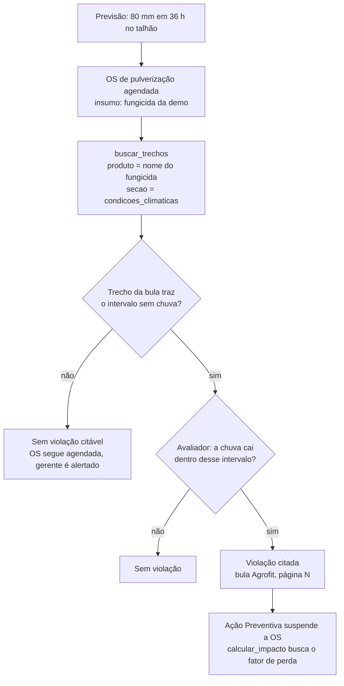
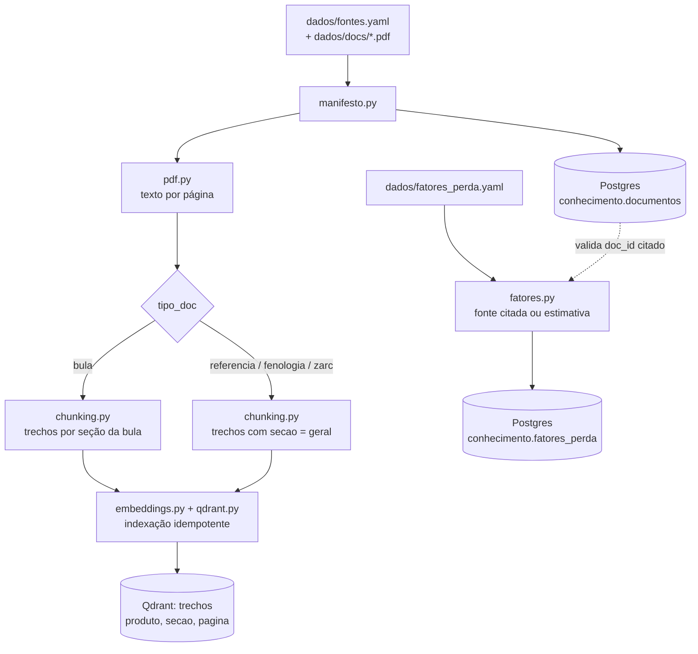
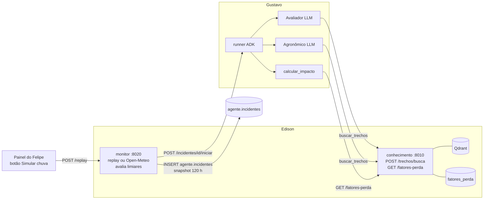

# TerraMind · Conhecimento e Clima (frente do Edison) — Implementation Plan

> **For agentic workers:** REQUIRED SUB-SKILL: Use superpowers:subagent-driven-development (recommended) or superpowers:executing-plans to implement this plan task-by-task. Steps use checkbox (`- [ ]`) syntax for tracking.

**Goal:** Entregar os trechos certos para o Avaliador de Risco decidir e citar (bulas de **defensivos agrícolas** do Agrofit → Qdrant, com `produto`, `secao` e `pagina` corretos), a ferramenta `buscar_trechos`, os fatores de perda via API e o Monitor de clima (Open-Meteo + replay) que abre incidentes.

**Foco (D2, 29/10):** só defensivos agrícolas (fungicida, herbicida, inseticida). Adubação saiu do escopo. Cenário da demo: chuva intensa × pulverização de defensivo agendada.

**Contratos e decisões:** [docs/contratos.md](../contratos.md). Os números citados neste plano são os de lá.

**Architecture:** Um serviço FastAPI com o pipeline offline junto (`base_agricola/`) e um serviço de monitor (`monitor/`), num monorepo com **um único ambiente Python na raiz** (`pyproject.toml` + `uv.lock`). O ingest lê os PDFs, divide em trechos por seção e indexa no Qdrant; a API serve a busca de trechos e os fatores de perda. **A decisão é só por RAG:** o Avaliador (LLM, frente do Gustavo) lê os trechos via `buscar_trechos` e decide a violação citando fonte e página. Não há extração de dados estruturados nem tabela de regras. O Monitor compara a previsão com limiares, grava em `agente.incidentes` e avisa o runner do ADK por HTTP.

**Spec:** [TerraMind — Arquitetura para desenvolvimento.md](../../TerraMind%20—%20Arquitetura%20para%20desenvolvimento.md) (revisada em 29/10). Seções usadas: Base de conhecimento, Modelo de dados, Fluxo do agente (etapa 1), Repositório e containers, Plano de 7 dias, Riscos, Divisão do time.

**Tech Stack:** Python ≥3.12, uv (ambiente único na raiz), FastAPI, Pydantic v2, SQLAlchemy 2 (Core, síncrono) + psycopg 3, qdrant-client, fastembed, PyMuPDF, PyYAML, Typer, httpx, pytest, respx, testcontainers, Ruff.

**Escopo da frente (spec, Divisão do time):** coleta das bulas; pipeline de ingest; Qdrant com chunking e metadados por produto e seção; ferramenta `buscar_trechos` e fatores de perda; depois, Monitor com Open-Meteo e modo replay (snapshot de 120 h). `consultar_regras`, extração e validação manual **saíram do plano** (29/10, Gustavo: "vamos decidir só por RAG").

**Estado:** Task 1 concluída (`437f3b6`, branch `feat/conhecimento-base`).

## Global Constraints

- **O trecho decide.** O Avaliador filtra por `produto` e lê o texto. Todo trecho precisa de `produto` (quando o documento é de um produto), `secao` e `pagina` corretos: um metadado errado vira uma decisão errada.
- Um trecho nunca atravessa páginas, para a citação de página ser exata.
- `Trecho.produto` tem exatamente o mesmo texto que `erp.insumos.produto` (contrato 1).
- Fator de perda tem fonte citada (`"<doc_id>:p.<N>"`) ou é declarado como estimativa (`"estimativa: <justificativa>"`). Sem fator cadastrado, a API responde 404 e o Gustavo deixa a perda em branco; nenhum valor é inventado.
- `fatores_perda.condicao` ∈ {`chuva`, `vento`, `umidade`, `temperatura`}, os mesmos valores de `ViolacaoOs.parametro` do Avaliador (contrato 11).
- `fatores_perda.tipo_insumo` usa os mesmos valores de `erp.insumos.tipo`: `fungicida`, `herbicida`, `inseticida` (contrato 15).
- Unidades fixas: vento em km/h, temperatura em °C, umidade em %, chuva em mm, tempo em horas.
- Fuso: `America/Sao_Paulo`. Todo `datetime` é *timezone-aware*.
- Configuração por variável de ambiente lida com `os.environ` (sem `config.py`): `DATABASE_URL`, `QDRANT_URL`, `EMBEDDING_MODEL`, `AGENTS_URL`, `CONHECIMENTO_URL`, `MONITOR_MODE` (`live` | `replay`).
- Commits em Conventional Commits, em português e no imperativo: `tipo(escopo): descrição`. Escopos: `base_agricola`, `monitor`, `tools`, `db`, `infra`, `docs`.

## Nomes

| O quê | Nome | Por quê |
|---|---|---|
| Pasta do código | `base_agricola/` | Escolha do Edison (29/10) |
| Schema no Postgres | `conhecimento` | Igual à spec e aos planos do Gustavo e do Felipe |
| Container e porta | `conhecimento:8010` | Igual à spec |
| Variável | `CONHECIMENTO_URL` | Igual à spec |
| Migration | `db/migrations/010_conhecimento.sql` | Contrato 2 |

Só a pasta mudou de nome (D3). Se o time quiser `base_agricola` em tudo, troca-se o schema, o container e a variável numa task própria.

## Contratos que esta frente usa

Texto completo em [docs/contratos.md](../contratos.md).

| # | Contrato | Status | Tasks |
|---|---|---|---|
| 1 | Nome do produto igual no ERP e no Qdrant | Aberto: falta escolher o defensivo | 4, 5 |
| 2 | Migrations (`010_conhecimento.sql`) | Fechado | 2 |
| 3 | Abertura de incidente (snapshot de 120 h, sem duplicar) | Fechado | 15 |
| 10 | `buscar_trechos` | Fechado | 11 |
| 11 | `GET /fatores-perda` | Fechado | 3, 10 |
| 12 | Unidades e fuso | Fechado | todas |
| 13 | Portas 8010 e 8020 | Fechado | 17 |
| 14 | Botão "Simular chuva" → `POST /replay` | Proposto | 16 |
| 15 | `tipo_insumo` ∈ {`fungicida`, `herbicida`, `inseticida`} | Proposto | 2, 10 |

### Pontos da spec a alinhar com o Gustavo

- O cenário da spec foi trocado para "chuva × pulverização de defensivo" (D2); o Gustavo confirma no PR.
- O Modelo de dados ainda lista `regras_aplicacao` e `tolerancia_fenologica`. Com D1, essas tabelas não existem.
- A árvore do repositório mostra `conhecimento/` e `ingest/` separados; aqui os dois estão em `base_agricola/`, com um ambiente só na raiz (D3).
- No Plano de 7 dias, o Monitor aparece na coluna do Felipe (dia 4); na Divisão do time, ele é do Edison. Este plano segue a Divisão do time.

## Review Focus

1. **Rodar o ingest duas vezes** não duplica pontos no Qdrant e remove os trechos de um documento que encolheu → testes na Task 6.
2. **Trecho certo para o Avaliador:** para cada produto da demo, `buscar_trechos("chuva após a aplicação", produto=...)` devolve o trecho com o limite entre os 3 primeiros, com a página certa → aceitação com os PDFs reais na Task 7.
3. **Produto escrito diferente** no `fontes.yaml` e no ERP faz a busca filtrada voltar vazia → contrato 1 e conferência no dia 2.
4. **Open-Meteo fora do ar ou lento** no modo `live`: o Monitor registra o erro, segue para o próximo talhão e não cai → teste na Task 15.
5. **Incidente duplicado:** enquanto existir incidente não encerrado no talhão, nenhum ciclo abre outro, mesmo dias depois → teste na Task 15.
6. **Cenário de replay gravado em data passada** não dispararia nada no dia da demo → rebase para "agora" com teste na Task 13.
7. **Snapshot completo:** o incidente guarda as 120 h da fonte, não só a janela de risco → teste na Task 15.

---

## Fluxogramas

### 1. Como a chuva vira uma OS suspensa

O defensivo pulverizado precisa de algumas horas sem chuva para agir; se chover antes, a chuva lava o produto da planta e o dinheiro é perdido. A bula diz quantas horas são. Quem decide é o Avaliador (LLM) do Gustavo, lendo o trecho da bula. O que esta frente garante é que o trecho certo chegue a ele.



### 2. Pipeline offline (roda antes da demo)



### 3. Durante a demo



---

## Mapa de arquivos

```
terra-mind/
├── pyproject.toml / uv.lock            # ambiente único do monorepo
├── base_agricola/                      # serviço :8010 + pipeline offline
│   ├── main.py                         # FastAPI: /health, rotas
│   ├── rotas_fatores.py                # GET /fatores-perda
│   ├── rotas_trechos.py                # POST /trechos/busca
│   ├── db.py                           # criar_engine()
│   ├── modelos.py                      # FatorPerda, Trecho, TrechoEncontrado
│   ├── repositorio.py                  # SQL do schema conhecimento
│   ├── embeddings.py                   # Embedder, FastEmbedEmbedder, EmbedderDeterministico
│   ├── qdrant.py                       # garantir_colecao, indexar
│   ├── busca.py                        # buscar(...)
│   ├── manifesto.py                    # Fonte, carregar_manifesto
│   ├── pdf.py                          # PaginaTexto, extrair_paginas
│   ├── chunking.py                     # dividir_em_trechos
│   ├── fatores.py                      # carregar_fatores
│   ├── ingest.py                       # CLI: indexar | carregar-fatores
│   ├── dados/
│   │   ├── fontes.yaml
│   │   ├── fatores_perda.yaml
│   │   └── docs/*.pdf                  # bulas de defensivos (Agrofit), fenologia, ZARC
│   ├── Dockerfile
│   └── tests/
├── monitor/                            # serviço :8020
│   ├── main.py                         # FastAPI + loop: /health, /status, /replay, /ciclo
│   ├── modelos.py                      # HoraPrevisao, Talhao, Gatilho, Limiares, ResultadoCiclo
│   ├── fontes.py                       # OpenMeteoFonte, ReplayFonte
│   ├── avaliacao.py                    # avaliar(...)
│   ├── repositorio.py                  # RepositorioMonitor
│   ├── notificador.py                  # NotificadorHttp
│   ├── ciclo.py                        # executar_ciclo(...)
│   ├── gravar.py                       # CLI que grava um cenário real
│   ├── scenarios/chuva_80mm.json
│   ├── Dockerfile
│   └── tests/
├── agents/tools/conhecimento.py        # buscar_trechos (PR para o Gustavo)
└── db/migrations/010_conhecimento.sql
```

Testes, sempre da raiz: `uv run pytest base_agricola`, `uv run pytest monitor`, `uv run pytest agents/tests/test_tools_conhecimento.py`. Lint: `uv run ruff check .`. Testes com Postgres usam `testcontainers` (`postgres:16`) e aplicam, em ordem, os SQL que existirem em `db/migrations/`. Enquanto o `001_erp.sql` e o `002_agente.sql` do Felipe não existirem, o monitor usa `monitor/tests/sql/contrato_minimo.sql` com `erp.talhoes(id, nome, lat, lon)` e `agente.incidentes(id, talhao_id, gatilho jsonb, previsao_snapshot jsonb, status, criado_em)`.

---

## Fase 1 — Base do serviço (branch `feat/conhecimento-base`, dia 1)

### Task 1: Esqueleto do serviço ✅ concluída (`437f3b6`)

`pyproject.toml` e `uv.lock` na raiz, `base_agricola/main.py` com `GET /health` e teste. Tasks seguintes usam `os.environ` em vez de `Settings`.

### Task 2: Schema `conhecimento` e repositório

**Files:**
- Create: `db/migrations/010_conhecimento.sql`, `base_agricola/db.py`, `base_agricola/modelos.py`, `base_agricola/repositorio.py`, `base_agricola/tests/test_repositorio.py`
- Modify: `base_agricola/tests/conftest.py` (fixture `engine` com testcontainers)

**Interfaces:**
- Produces:
  - Tabelas em `conhecimento.`:
    - `documentos(id text PK, titulo text NOT NULL, tipo_doc text NOT NULL CHECK IN ('bula','referencia','fenologia','zarc'), produto text NULL, culturas text[] NOT NULL DEFAULT '{}', url text, arquivo text)`;
    - `fatores_perda(id serial PK, tipo_insumo text NOT NULL, condicao text NOT NULL CHECK IN ('chuva','vento','umidade','temperatura'), fator numeric NOT NULL CHECK (fator BETWEEN 0 AND 1), fonte_ou_estimativa text NOT NULL, UNIQUE (tipo_insumo, condicao))`.
  - `criar_engine(url: str | None = None) -> Engine`, com `url` padrão em `os.environ["DATABASE_URL"]`.
  - `FatorPerda(BaseModel)`: `tipo_insumo: str`, `condicao: Literal["chuva","vento","umidade","temperatura"]`, `fator: float = Field(ge=0, le=1)`, `fonte_ou_estimativa: str`.
  - `RepositorioConhecimento(engine)`:
    - `fator_perda(tipo_insumo, condicao) -> FatorPerda | None`;
    - `upsert_fator(fator: FatorPerda) -> None`, por `(tipo_insumo, condicao)`;
    - `upsert_documento(id, titulo, tipo_doc, produto, culturas, url, arquivo) -> None`;
    - `ids_documentos() -> set[str]`.

- [ ] **Step 1: Testes que falham** (Postgres via testcontainers, com a migration aplicada)

```python
def test_fator_inexistente_volta_none(repo):
    assert repo.fator_perda("fungicida", "chuva") is None

def test_upsert_fator_substitui(repo):
    repo.upsert_fator(FatorPerda(tipo_insumo="fungicida", condicao="chuva", fator=0.3, fonte_ou_estimativa="estimativa: x"))
    repo.upsert_fator(FatorPerda(tipo_insumo="fungicida", condicao="chuva", fator=0.4, fonte_ou_estimativa="estimativa: y"))
    assert repo.fator_perda("fungicida", "chuva").fator == 0.4

def test_condicao_fora_do_contrato_rejeitada_no_banco(engine):
    with pytest.raises(IntegrityError), engine.begin() as c:
        c.execute(text("INSERT INTO conhecimento.fatores_perda (tipo_insumo, condicao, fator, fonte_ou_estimativa) "
                       "VALUES ('fungicida', 'lavagem', 0.3, 'estimativa: x')"))

def test_documentos_registrados(repo):
    repo.upsert_documento("bula-x", "Bula X", "bula", "Produto X", ["soja"], "https://...", "docs/x.pdf")
    assert repo.ids_documentos() == {"bula-x"}
```

- [ ] **Step 2:** `uv run pytest base_agricola/tests/test_repositorio.py -v` → FAIL
- [ ] **Step 3:** Escrever a migration, `db.py`, `modelos.py` e o repositório, com SQL explícito via `sqlalchemy.text`.
- [ ] **Step 4:** `uv run pytest base_agricola -v && uv run ruff check .` → PASS
- [ ] **Step 5:** `git commit -m "feat(db): adiciona schema conhecimento"` (migration) e `git commit -m "feat(base_agricola): adiciona repositório de documentos e fatores de perda"`

### Task 3: `GET /fatores-perda`

**Files:**
- Create: `base_agricola/rotas_fatores.py`, `base_agricola/tests/test_api_fatores.py`
- Modify: `base_agricola/main.py` (dependência `get_repo`, incluir o router)

**Interfaces:**
- Consumes: `RepositorioConhecimento` (Task 2).
- Produces: `GET /fatores-perda?tipo_insumo=&condicao=` → `FatorPerda` ou 404 `{"detail": "fator_nao_cadastrado"}`. `condicao` fora do contrato → 422.

- [ ] **Step 1: Testes que falham** (repositório falso via `app.dependency_overrides`, sem Postgres)

```python
def test_fator_encontrado(client_com_fatores):
    r = client_com_fatores({("fungicida", "chuva"): fator_exemplo()}).get(
        "/fatores-perda", params={"tipo_insumo": "fungicida", "condicao": "chuva"})
    assert r.status_code == 200 and r.json()["fator"] == 0.3

def test_fator_inexistente_404(client_com_fatores):
    r = client_com_fatores({}).get("/fatores-perda", params={"tipo_insumo": "fungicida", "condicao": "chuva"})
    assert r.status_code == 404 and r.json()["detail"] == "fator_nao_cadastrado"

def test_condicao_invalida_422(client_com_fatores):
    r = client_com_fatores({}).get("/fatores-perda", params={"tipo_insumo": "fungicida", "condicao": "lavagem"})
    assert r.status_code == 422
```

- [ ] **Step 2:** `uv run pytest base_agricola/tests/test_api_fatores.py -v` → FAIL
- [ ] **Step 3:** Implementar o router.
- [ ] **Step 4:** `uv run pytest base_agricola -v && uv run ruff check .` → PASS
- [ ] **Step 5:** `git commit -m "feat(base_agricola): expõe fatores de perda"`

**Fim da fase:** PR `feat/conhecimento-base` → revisão do Gustavo (e do Felipe, pela migration).

---

## Fase 2 — Ingest e Qdrant (branch `feat/ingest-qdrant`, dia 2)

### Task 4: Manifesto de fontes e texto por página

**Files:**
- Create: `base_agricola/manifesto.py`, `base_agricola/pdf.py`, `base_agricola/dados/fontes.yaml` (exemplo comentado), `base_agricola/tests/test_manifesto.py`, `base_agricola/tests/test_pdf.py`
- Modify: `pyproject.toml` (`uv add pymupdf pyyaml typer`)

**Interfaces:**
- Produces:
  - `Fonte(BaseModel)`: `id`, `titulo`, `tipo_doc: Literal["bula","referencia","fenologia","zarc"]`, `produto: str | None`, `culturas: list[str]`, `arquivo: Path`, `url: str`. Validação:
    - `bula` → `produto` obrigatório;
    - `referencia` → `produto` opcional (ex.: material técnico sobre ferrugem da soja, sem produto);
    - `fenologia` e `zarc` → `produto` nulo.
  - `carregar_manifesto(caminho: Path) -> list[Fonte]`; `arquivo` é relativo a `base_agricola/dados/`; ids repetidos são erro.
  - `PaginaTexto(pagina: int, texto: str)`, com páginas numeradas a partir de 1.
  - `extrair_paginas(pdf: Path) -> list[PaginaTexto]`.

- [ ] **Step 1: Testes que falham** (PDF de teste gerado com PyMuPDF em `tmp_path`)

```python
def test_extrai_paginas_numeradas(pdf_duas_paginas):
    paginas = extrair_paginas(pdf_duas_paginas)
    assert [p.pagina for p in paginas] == [1, 2]
    assert "CONDIÇÕES CLIMÁTICAS" in paginas[0].texto

def test_bula_sem_produto_invalida(tmp_path):
    with pytest.raises(ValidationError):
        carregar_manifesto(yaml_com(tmp_path, tipo_doc="bula", produto=None))

def test_fenologia_com_produto_invalida(tmp_path):
    with pytest.raises(ValidationError):
        carregar_manifesto(yaml_com(tmp_path, tipo_doc="fenologia", produto="Fungicida X"))

def test_id_repetido_invalido(tmp_path):
    with pytest.raises(ValueError):
        carregar_manifesto(yaml_com_ids(tmp_path, ["bula-x", "bula-x"]))
```

- [ ] **Step 2:** `uv run pytest base_agricola/tests/test_manifesto.py base_agricola/tests/test_pdf.py -v` → FAIL
- [ ] **Step 3:** Implementar com `pymupdf.open(...)` e `page.get_text("text")`.
- [ ] **Step 4:** `uv run pytest base_agricola -v && uv run ruff check .` → PASS
- [ ] **Step 5:** `git commit -m "feat(base_agricola): lê manifesto de fontes e extrai texto por página"`

### Task 5: Chunking por seção

**Files:**
- Create: `base_agricola/chunking.py`, `base_agricola/tests/test_chunking.py`
- Modify: `base_agricola/modelos.py` (`Trecho`)

**Interfaces:**
- Produces:
  - `Trecho(BaseModel)`: `doc_id`, `produto: str | None`, `tipo_doc`, `culturas: list[str]`, `pagina: int`, `secao: Literal["condicoes_climaticas","modo_aplicacao","intervalo_seguranca","outra","geral"]`, `ordem: int`, `texto: str`.
  - `dividir_em_trechos(fonte: Fonte, paginas: list[PaginaTexto], max_chars: int = 1200) -> list[Trecho]`.

Regras de corte:
- Em bula, os cabeçalhos são reconhecidos sem diferenciar maiúsculas nem acentos:
  - "CONDIÇÕES CLIMÁTICAS" ou "CONDIÇÕES DE APLICAÇÃO" → `condicoes_climaticas`;
  - "MODO DE APLICAÇÃO" → `modo_aplicacao`;
  - "INTERVALO DE SEGURANÇA" → `intervalo_seguranca`;
  - texto antes do primeiro cabeçalho → `outra`.
- A seção vale até o próximo cabeçalho, inclusive na página seguinte.
- O corte é por parágrafo, até `max_chars`, sem atravessar página.
- Referência, fenologia e ZARC usam `secao="geral"` e mantêm o `produto` da fonte.

- [ ] **Step 1: Testes que falham**

```python
def test_secao_continua_na_pagina_seguinte(fonte_bula):
    paginas = [PaginaTexto(pagina=1, texto="CONDIÇÕES CLIMÁTICAS\nVento até 10 km/h."),
               PaginaTexto(pagina=2, texto="Não aplicar com chuva prevista em 4 horas.")]
    trechos = dividir_em_trechos(fonte_bula, paginas)
    assert trechos[-1].pagina == 2 and trechos[-1].secao == "condicoes_climaticas"

def test_cabecalho_sem_acento_reconhecido(fonte_bula):
    trechos = dividir_em_trechos(fonte_bula, [PaginaTexto(pagina=1, texto="Condicoes climaticas\nVento até 10 km/h.")])
    assert trechos[0].secao == "condicoes_climaticas"

def test_trecho_respeita_tamanho_e_pagina(fonte_bula):
    trechos = dividir_em_trechos(fonte_bula, [PaginaTexto(pagina=1, texto="\n\n".join(["x" * 500] * 6))])
    assert all(len(t.texto) <= 1200 and t.pagina == 1 for t in trechos)

def test_documento_nao_bula_usa_geral(fonte_fenologia, paginas_simples):
    trechos = dividir_em_trechos(fonte_fenologia, paginas_simples)
    assert {(t.secao, t.produto) for t in trechos} == {("geral", None)}

def test_bula_guarda_produto_em_todos_os_trechos(fonte_bula, paginas_simples):
    assert {t.produto for t in dividir_em_trechos(fonte_bula, paginas_simples)} == {"Fungicida X"}
```

- [ ] **Step 2:** `uv run pytest base_agricola/tests/test_chunking.py -v` → FAIL
- [ ] **Step 3:** Implementar, normalizando acentos com `unicodedata` para casar os cabeçalhos.
- [ ] **Step 4:** `uv run pytest base_agricola -v && uv run ruff check .` → PASS
- [ ] **Step 5:** `git commit -m "feat(base_agricola): divide documentos em trechos por seção sem cruzar páginas"`

### Task 6: Embeddings, indexação idempotente e comando `indexar`

**Files:**
- Create: `base_agricola/embeddings.py`, `base_agricola/qdrant.py`, `base_agricola/ingest.py`, `base_agricola/tests/test_qdrant.py`, `base_agricola/tests/test_ingest_indexar.py`

**Interfaces:**
- Produces:
  - `class Embedder(Protocol)`: `dimensao: int` e `embed(textos: list[str]) -> list[list[float]]`.
  - `FastEmbedEmbedder(model_name)` para produção, com `model_name` padrão em `EMBEDDING_MODEL` ou `"sentence-transformers/paraphrase-multilingual-MiniLM-L12-v2"`; `EmbedderDeterministico(dimensao=32)`, baseado em hash, para testes.
  - `garantir_colecao(client, nome, dimensao)`: distância cosseno e índices de payload `keyword` em `produto`, `culturas`, `secao` e `doc_id`.
  - `indexar(client, embedder, trechos, colecao="trechos") -> int`: apaga os pontos de cada `doc_id` presente e faz upsert com `id = uuid5(NAMESPACE_URL, f"{doc_id}:{pagina}:{secao}:{ordem}")`; payload = `Trecho` inteiro.
  - CLI `uv run python -m base_agricola.ingest indexar [--manifesto base_agricola/dados/fontes.yaml] [--doc ID]`: para cada fonte, registra em `conhecimento.documentos`, extrai as páginas, gera os trechos e indexa. Uma falha num documento vai para o log e o comando segue; no fim imprime quantos trechos cada documento gerou.

- [ ] **Step 1: Testes que falham** (`QdrantClient(":memory:")`)

```python
def test_indexar_duas_vezes_nao_duplica(client_mem, trechos_exemplo):
    emb = EmbedderDeterministico()
    indexar(client_mem, emb, trechos_exemplo, "trechos")
    indexar(client_mem, emb, trechos_exemplo, "trechos")
    assert client_mem.count("trechos").count == len(trechos_exemplo)

def test_reindexar_documento_menor_remove_sobras(client_mem, trechos_exemplo):
    emb = EmbedderDeterministico()
    indexar(client_mem, emb, trechos_exemplo, "trechos")
    indexar(client_mem, emb, trechos_exemplo[:1], "trechos")
    assert client_mem.count("trechos").count == 1

def test_cli_documento_com_falha_nao_para_os_outros(cli, manifesto_um_pdf_quebrado):
    resultado = cli("indexar", "--manifesto", manifesto_um_pdf_quebrado)
    assert resultado.exit_code == 0 and "erro" in resultado.output
```

- [ ] **Step 2:** `uv run pytest base_agricola/tests/test_qdrant.py base_agricola/tests/test_ingest_indexar.py -v` → FAIL
- [ ] **Step 3:** Implementar o embedder, `garantir_colecao`, `indexar` e o comando, com engine e cliente Qdrant vindos de `DATABASE_URL` e `QDRANT_URL`.
- [ ] **Step 4:** `uv run pytest base_agricola -v && uv run ruff check .` → PASS
- [ ] **Step 5:** `git commit -m "feat(base_agricola): indexa trechos no Qdrant de forma idempotente"`

### Task 7: Busca de trechos (`POST /trechos/busca`)

**Files:**
- Create: `base_agricola/busca.py`, `base_agricola/rotas_trechos.py`, `base_agricola/tests/test_busca.py`
- Modify: `base_agricola/modelos.py` (`TrechoEncontrado`), `base_agricola/main.py`

**Interfaces:**
- Consumes: `Embedder`, `indexar` (Task 6).
- Produces:
  - `TrechoEncontrado(BaseModel)`: `texto`, `fonte_doc`, `pagina`, `secao`, `produto`, `score: float`.
  - `buscar(client, embedder, colecao, consulta, produto=None, cultura=None, secao=None, limite=3) -> list[TrechoEncontrado]`. O filtro `must` usa só os parâmetros informados.
  - `POST /trechos/busca` com corpo `{"consulta": str, "produto"?: str, "cultura"?: str, "secao"?: str, "limite": int = 3 (1..10)}` → `list[TrechoEncontrado]`. Qdrant fora do ar → 503 `{"detail": "qdrant_indisponivel"}`.

- [ ] **Step 1: Testes que falham**

```python
def test_filtra_por_produto(indice_com_dois_produtos):
    res = buscar(*indice_com_dois_produtos, consulta="chuva", produto="Fungicida X")
    assert res and all(t.produto == "Fungicida X" for t in res)

def test_filtra_por_secao(indice_bula):
    res = buscar(*indice_bula, consulta="chuva", secao="condicoes_climaticas")
    assert res and all(t.secao == "condicoes_climaticas" for t in res)

def test_limite_maior_que_10_rejeitado(client_busca):
    assert client_busca.post("/trechos/busca", json={"consulta": "chuva", "limite": 11}).status_code == 422

def test_sem_resultado_retorna_lista_vazia(client_busca):
    r = client_busca.post("/trechos/busca", json={"consulta": "chuva", "produto": "Inexistente"})
    assert r.status_code == 200 and r.json() == []
```

- [ ] **Step 2:** `uv run pytest base_agricola/tests/test_busca.py -v` → FAIL
- [ ] **Step 3:** Implementar com `client.query_points(...)` e `models.Filter(must=[FieldCondition(...)])`.
- [ ] **Step 4:** `uv run pytest base_agricola -v && uv run ruff check .` → PASS
- [ ] **Step 5:** `git commit -m "feat(base_agricola): adiciona busca de trechos com filtro por produto e seção"`
- [ ] **Step 6 (aceitação com os PDFs reais, dia 2):** para cada produto da demo, `POST /trechos/busca` com `{"consulta": "chuva após a aplicação", "produto": "<produto>"}` traz o trecho com o limite entre os 3 primeiros, e a página confere com o PDF. Se não trouxer, ajustar os cabeçalhos da Task 5 ou o `max_chars` antes de seguir. **É o teste que mais importa para a demo.**

**Fim da fase:** PR `feat/ingest-qdrant`.

---

## ~~Tasks 8 e 9~~ — removidas em 29/10

Extração de regras com LLM e API de revisão manual saíram do plano: a decisão é só por RAG (mensagem do Gustavo, 29/10). Com elas saíram também `regras_aplicacao`, `tolerancia_fenologica`, o seed de regras fake, `GET /regras`, `GET /tolerancias` e `consultar_regras`. A numeração das outras tasks foi mantida porque o plano do Gustavo cita a Task 11.

---

## Fase 3 — Ferramenta para os agentes (branch `feat/tools-conhecimento`, dia 2–3, PR para o Gustavo)

### Task 11: `buscar_trechos` para o ADK

**Files:**
- Create: `agents/tools/__init__.py`, `agents/tools/conhecimento.py`, `agents/tests/test_tools_conhecimento.py`

**Interfaces:**
- Consumes: `POST /trechos/busca` (Task 7), em `CONHECIMENTO_URL`.
- Produces: `buscar_trechos(consulta: str, produto: str | None = None, secao: str | None = None) -> dict` → `{"trechos": [{"texto", "fonte_doc", "pagina", "secao", "produto"}]}`.
  - É a ferramenta do caminho crítico: o Avaliador decide com ela e o Agronômico cita com ela.
  - A docstring, em português, diz que para achar limites de aplicação a consulta vai filtrada por `produto` e, em bula, por `secao="condicoes_climaticas"`; e que lista vazia significa "o documento não traz esse limite".
  - Erro de rede, timeout (5 s) ou 5xx → `{"trechos": [], "erro": "servico_conhecimento_indisponivel"}`. Nunca levanta exceção.
  - Alinhar com o Gustavo se ela vira um wrapper do `ConhecimentoHttp` dele, para não haver dois clientes HTTP.

- [ ] **Step 1: Testes que falham** (respx)

```python
@respx.mock
def test_devolve_trechos_com_citacao():
    respx.post(f"{URL}/trechos/busca").respond(200, json=[trecho_json(pagina=4)])
    assert buscar_trechos("chuva", produto="Fungicida X")["trechos"][0]["pagina"] == 4

@respx.mock
def test_envia_so_filtros_informados():
    rota = respx.post(f"{URL}/trechos/busca").respond(200, json=[])
    buscar_trechos("chuva", produto="Fungicida X")
    assert json.loads(rota.calls[0].request.content) == {"consulta": "chuva", "produto": "Fungicida X"}

@respx.mock
def test_servico_fora_do_ar():
    respx.post(f"{URL}/trechos/busca").mock(side_effect=httpx.ConnectError("x"))
    assert buscar_trechos("chuva") == {"trechos": [], "erro": "servico_conhecimento_indisponivel"}
```

- [ ] **Step 2:** `uv run pytest agents/tests/test_tools_conhecimento.py -v` → FAIL
- [ ] **Step 3:** Implementar com `httpx.Client(base_url=os.environ["CONHECIMENTO_URL"], timeout=5)`.
- [ ] **Step 4:** `uv run pytest agents/tests/test_tools_conhecimento.py -v && uv run ruff check .` → PASS
- [ ] **Step 5:** `git commit -m "feat(tools): adiciona buscar_trechos para os agentes"`

---

## Fase 4 — Fatores de perda (branch `feat/fatores-perda`, dia 3)

### Task 10: Carga dos fatores de perda

**Files:**
- Create: `base_agricola/fatores.py`, `base_agricola/dados/fatores_perda.yaml`, `base_agricola/tests/test_fatores.py`
- Modify: `base_agricola/ingest.py` (comando `carregar-fatores`)

**Interfaces:**
- Consumes: `RepositorioConhecimento.upsert_fator` e `ids_documentos` (Task 2).
- Produces:
  - `carregar_fatores(caminho: Path, docs_existentes: set[str]) -> list[FatorPerda]`.
  - `fonte_ou_estimativa` aceita `"<doc_id>:p.<N>"`, com `doc_id` em `conhecimento.documentos`, ou `"estimativa: <justificativa>"` com justificativa não vazia. Outro valor é erro.
  - `condicao` fora do contrato 11 é erro. `tipo_insumo` fora do contrato 15 (`fungicida`, `herbicida`, `inseticida`) é erro.
  - CLI `uv run python -m base_agricola.ingest carregar-fatores`: faz upsert por `(tipo_insumo, condicao)`.
  - O YAML da demo tem pelo menos o fator `(tipo do defensivo da demo, chuva)`.

- [ ] **Step 1: Testes que falham**

```python
def test_aceita_citacao_e_estimativa(tmp_path):
    fatores = carregar_fatores(yaml_fatores(tmp_path, ["bula-x:p.4", "estimativa: produto lavado pela chuva antes de agir"]), {"bula-x"})
    assert len(fatores) == 2

def test_rejeita_tipo_insumo_fora_do_contrato(tmp_path):
    with pytest.raises(ValueError):
        carregar_fatores(yaml_fatores(tmp_path, ["estimativa: x"], tipo_insumo="fertilizante"), set())

def test_rejeita_doc_inexistente(tmp_path):
    with pytest.raises(ValueError):
        carregar_fatores(yaml_fatores(tmp_path, ["outra-bula:p.1"]), {"bula-x"})

def test_rejeita_estimativa_sem_justificativa(tmp_path):
    with pytest.raises(ValueError):
        carregar_fatores(yaml_fatores(tmp_path, ["estimativa: "]), set())

def test_rejeita_condicao_fora_do_contrato(tmp_path):
    with pytest.raises(ValueError):
        carregar_fatores(yaml_fatores(tmp_path, ["estimativa: x"], condicao="lavagem"), set())
```

- [ ] **Step 2:** `uv run pytest base_agricola/tests/test_fatores.py -v` → FAIL
- [ ] **Step 3:** Implementar o loader e o comando.
- [ ] **Step 4:** `uv run pytest base_agricola -v && uv run ruff check .` → PASS
- [ ] **Step 5:** `git commit -m "feat(base_agricola): carrega fatores de perda com fonte ou estimativa declarada"`

**Fim da fase:** PR `feat/fatores-perda`. Com ele, o `calcular_impacto` do Gustavo passa a mostrar a perda em R$.

---

## Fase 5 — Monitor de clima (branch `feat/monitor`, dia 4)

### Task 12: Modelos e fonte Open-Meteo

**Files:**
- Create: `monitor/__init__.py`, `monitor/modelos.py`, `monitor/fontes.py`, `monitor/tests/__init__.py`, `monitor/tests/fixtures/open_meteo.json`, `monitor/tests/test_open_meteo.py`

**Interfaces:**
- Produces:
  - `HoraPrevisao(BaseModel)`: `ts: AwareDatetime`, `chuva_mm`, `vento_kmh`, `umidade_pct`, `temp_c: float`.
  - `class FontePrevisao(Protocol)`: `obter(lat, lon, agora) -> list[HoraPrevisao]`.
  - `parse_open_meteo(payload: dict) -> list[HoraPrevisao]`, que localiza `hourly.time` com `ZoneInfo(payload["timezone"])`.
  - `OpenMeteoFonte(http: httpx.Client)`: `GET https://api.open-meteo.com/v1/forecast` com `hourly=precipitation,wind_speed_10m,relative_humidity_2m,temperature_2m`, `forecast_days=5`, `timezone=America/Sao_Paulo`, `wind_speed_unit=kmh`, timeout de 10 s. Erro HTTP ou timeout → `FontePrevisaoIndisponivel`.

- [ ] **Step 1: Testes que falham**

```python
@respx.mock
def test_converte_resposta(fonte):
    respx.get(OPEN_METEO).respond(200, json=fixture("open_meteo.json"))
    horas = fonte.obter(-17.79, -50.92, AGORA)
    assert len(horas) == 120
    assert horas[0].ts.utcoffset() == timedelta(hours=-3)

@respx.mock
def test_erro_http_vira_indisponivel(fonte):
    respx.get(OPEN_METEO).respond(500)
    with pytest.raises(FontePrevisaoIndisponivel):
        fonte.obter(-17.79, -50.92, AGORA)
```

- [ ] **Step 2:** `uv run pytest monitor -v` → FAIL
- [ ] **Step 3:** Implementar. A fixture é uma resposta real gravada com `curl` para Rio Verde (-17.79, -50.92), a coordenada do seed do Felipe.
- [ ] **Step 4:** `uv run pytest monitor -v && uv run ruff check .` → PASS
- [ ] **Step 5:** `git commit -m "feat(monitor): adiciona cliente Open-Meteo com horários no fuso local"`

### Task 13: Modo replay e `chuva_80mm.json`

**Files:**
- Create: `monitor/gravar.py`, `monitor/scenarios/chuva_80mm.json`, `monitor/tests/test_replay.py`
- Modify: `monitor/fontes.py` (`ReplayFonte`)

**Interfaces:**
- Consumes: `parse_open_meteo` (Task 12).
- Produces:
  - `ReplayFonte(caminho: Path)`: implementa `FontePrevisao`, ignora lat/lon, lê o JSON no formato Open-Meteo e desloca todos os horários pelo mesmo delta para que a primeira hora seja `agora` truncado na hora.
  - CLI `uv run python -m monitor.gravar --lat <float> --lon <float> --saida monitor/scenarios/<nome>.json`.
  - `chuva_80mm.json`: gravado de verdade e editado à mão para somar 80 mm nas primeiras 36 h, mantendo as 120 h.

- [ ] **Step 1: Testes que falham**

```python
def test_rebase_para_agora():
    horas = ReplayFonte(CENARIOS / "chuva_80mm.json").obter(0, 0, datetime(2026, 11, 3, 14, 37, tzinfo=SP))
    assert horas[0].ts == datetime(2026, 11, 3, 14, 0, tzinfo=SP)
    assert horas[1].ts - horas[0].ts == timedelta(hours=1)

def test_cenario_soma_80mm_em_36h_e_tem_120h():
    horas = ReplayFonte(CENARIOS / "chuva_80mm.json").obter(0, 0, AGORA)
    assert len(horas) == 120
    assert sum(h.chuva_mm for h in horas[:36]) == pytest.approx(80, abs=0.1)
```

- [ ] **Step 2:** `uv run pytest monitor/tests/test_replay.py -v` → FAIL
- [ ] **Step 3:** Implementar `ReplayFonte` e `gravar`, gravar o cenário e editá-lo.
- [ ] **Step 4:** `uv run pytest monitor -v && uv run ruff check .` → PASS
- [ ] **Step 5:** `git commit -m "feat(monitor): adiciona modo replay e cenário de chuva de 80 mm"`

### Task 14: Avaliação dos limiares

**Files:**
- Create: `monitor/avaliacao.py`, `monitor/tests/test_avaliacao.py`
- Modify: `monitor/modelos.py` (`Limiares`, `Gatilho`)

**Interfaces:**
- Produces:
  - `Limiares(chuva_mm=20, vento_kmh=15, umidade_min_pct=50, janela_h=48)`, com valores de partida lidos de `LIMIAR_CHUVA_MM`, `LIMIAR_VENTO_KMH`, `LIMIAR_UMIDADE_MIN_PCT` e `JANELA_RISCO_H` quando definidos.
  - `Gatilho(BaseModel)`: `tipo: Literal["chuva","vento","umidade"]`, `valor`, `limiar`, `inicio: AwareDatetime`, `fim: AwareDatetime`. O Contexto do Gustavo calcula a janela de risco com `min(inicio)` e `max(fim)`.
  - `avaliar(horas, limiares, agora) -> list[Gatilho]`. A janela vai de `agora` até `agora + janela_h`. Dispara quando:
    - **chuva:** a soma na janela é ≥ `limiar` (`inicio`/`fim` = primeira e última hora com chuva > 0);
    - **vento:** o máximo é ≥ `limiar`;
    - **umidade:** o mínimo é < `limiar`.
    - Para vento e umidade, `inicio`/`fim` = horas em que o limiar é ultrapassado.

- [ ] **Step 1: Testes que falham**

```python
def test_chuva_80mm_dispara():
    g = avaliar(horas_com_chuva(total=80, em_horas=12), LIMIARES, AGORA)
    assert [x.tipo for x in g] == ["chuva"] and g[0].valor == pytest.approx(80)

def test_abaixo_do_limiar_nao_dispara():
    assert avaliar(horas_com_chuva(total=19.9, em_horas=12), LIMIARES, AGORA) == []

def test_chuva_fora_da_janela_ignorada():
    assert avaliar(horas_com_chuva(total=80, em_horas=6, comecando_em_h=50), LIMIARES, AGORA) == []

def test_sem_horas_nao_dispara():
    assert avaliar([], LIMIARES, AGORA) == []
```

- [ ] **Step 2:** `uv run pytest monitor/tests/test_avaliacao.py -v` → FAIL
- [ ] **Step 3:** Implementar.
- [ ] **Step 4:** `uv run pytest monitor -v && uv run ruff check .` → PASS
- [ ] **Step 5:** `git commit -m "feat(monitor): avalia previsão contra limiares de chuva, vento e umidade"`

### Task 15: Ciclo, incidentes sem duplicar e aviso aos agentes

**Files:**
- Create: `monitor/repositorio.py`, `monitor/notificador.py`, `monitor/ciclo.py`, `monitor/tests/test_ciclo.py`, `monitor/tests/test_repositorio_pg.py`, `monitor/tests/sql/contrato_minimo.sql`

**Interfaces:**
- Consumes: `FontePrevisao` (Tasks 12–13), `avaliar` (Task 14), contrato 3.
- Produces:
  - `Talhao(id, nome, lat, lon)`.
  - `RepositorioMonitor(engine)`:
    - `talhoes(ids: list[int] | None = None) -> list[Talhao]`;
    - `tem_incidente_aberto(talhao_id) -> bool`: existe incidente do talhão com `status <> 'encerrado'`, **sem filtro de tempo** (spec: `aguardando_decisao_manual` bloqueia duplicatas);
    - `criar_incidente(talhao_id, gatilhos, snapshot) -> int`: `status = 'aberto'`, `gatilho` = lista de `Gatilho` em JSONB, `previsao_snapshot` = **todas** as horas da fonte (120 h) em JSONB.
  - `NotificadorHttp(agents_url)`: `iniciar(incidente_id)` → `POST {agents_url}/incidentes/{id}/iniciar`, timeout de 5 s.
  - `ResultadoCiclo(incidentes: list[int], erros: list[str], executado_em: AwareDatetime)`.
  - `executar_ciclo(fonte, repo, notificador, limiares, agora, talhao_ids=None) -> ResultadoCiclo`:
    - talhão com erro na fonte ou no aviso vai para `erros`, e o ciclo segue;
    - se o aviso falhar, o incidente continua gravado.

- [ ] **Step 1: Testes que falham** (fakes em memória; o de repositório usa Postgres)

```python
def test_abre_um_incidente_por_talhao(fakes):
    r = executar_ciclo(fakes.fonte_chuva, fakes.repo, fakes.notificador, LIMIARES, AGORA)
    assert r.incidentes == [1] and fakes.notificador.chamadas == [1]

def test_segundo_ciclo_nao_duplica(fakes):
    executar_ciclo(fakes.fonte_chuva, fakes.repo, fakes.notificador, LIMIARES, AGORA)
    assert executar_ciclo(fakes.fonte_chuva, fakes.repo, fakes.notificador, LIMIARES, AGORA).incidentes == []

def test_snapshot_guarda_todas_as_horas(fakes):
    executar_ciclo(fakes.fonte_chuva, fakes.repo, fakes.notificador, LIMIARES, AGORA)
    assert len(fakes.repo.snapshots[1]) == len(fakes.fonte_chuva.horas)   # 120

def test_fonte_falha_em_um_talhao_segue_nos_outros(fakes_dois_talhoes_um_quebrado):
    r = executar_ciclo(*fakes_dois_talhoes_um_quebrado, LIMIARES, AGORA)
    assert len(r.incidentes) == 1 and len(r.erros) == 1

def test_falha_no_aviso_mantem_incidente(fakes_notificador_quebrado):
    r = executar_ciclo(*fakes_notificador_quebrado, LIMIARES, AGORA)
    assert r.incidentes == [1] and "notificar" in r.erros[0]

def test_incidente_antigo_em_decisao_manual_bloqueia(repo_pg, talhao_id):  # Postgres
    iid = repo_pg.criar_incidente(talhao_id, [GATILHO], [])
    mudar_status(repo_pg, iid, "aguardando_decisao_manual", criado_ha_dias=5)
    assert repo_pg.tem_incidente_aberto(talhao_id) is True

def test_incidente_encerrado_nao_bloqueia(repo_pg, talhao_id):  # Postgres
    iid = repo_pg.criar_incidente(talhao_id, [GATILHO], [])
    mudar_status(repo_pg, iid, "encerrado")
    assert repo_pg.tem_incidente_aberto(talhao_id) is False
```

- [ ] **Step 2:** `uv run pytest monitor/tests/test_ciclo.py monitor/tests/test_repositorio_pg.py -v` → FAIL
- [ ] **Step 3:** Implementar o repositório, o notificador e o ciclo.
- [ ] **Step 4:** `uv run pytest monitor -v && uv run ruff check .` → PASS
- [ ] **Step 5:** `git commit -m "feat(monitor): abre incidentes sem duplicar e avisa o runner"`

### Task 16: API do monitor e loop em background

**Files:**
- Create: `monitor/main.py`, `monitor/tests/test_api.py`

**Interfaces:**
- Consumes: `executar_ciclo`, `OpenMeteoFonte`, `ReplayFonte`, `RepositorioMonitor`, `NotificadorHttp`.
- Produces:
  - Lifespan: com `MONITOR_MODE=live`, uma task asyncio roda `await asyncio.to_thread(executar_ciclo, ...)` a cada `MONITOR_INTERVAL_MIN` (padrão 30) e captura qualquer exceção do ciclo. Com `replay` (padrão), não cria loop.
  - `GET /health` → `{"status": "ok"}`.
  - `GET /status` → `{"modo", "ultimo_ciclo_em": str | None, "ultimos_incidentes": list[int], "ultimos_erros": list[str]}`.
  - `POST /replay` com `{"cenario": str, "talhao_id"?: int}` (contrato 14): roda um ciclo com `ReplayFonte` → `{"incidentes": [...], "erros": [...]}`. `cenario` fora de `^[a-z0-9_]+\.json$` → 422; arquivo inexistente em `monitor/scenarios/` → 404.
  - `POST /ciclo` força um ciclo com `OpenMeteoFonte`.

- [ ] **Step 1: Testes que falham** (dependências sobrescritas com os fakes da Task 15)

```python
def test_replay_abre_incidente(client):
    r = client.post("/replay", json={"cenario": "chuva_80mm.json"})
    assert r.status_code == 200 and r.json()["incidentes"]

def test_replay_rejeita_caminho(client):
    assert client.post("/replay", json={"cenario": "../.env"}).status_code == 422

def test_replay_cenario_inexistente(client):
    assert client.post("/replay", json={"cenario": "nao_existe.json"}).status_code == 404

def test_modo_replay_nao_inicia_loop(client_replay):
    assert client_replay.get("/status").json() == {"modo": "replay", "ultimo_ciclo_em": None, "ultimos_incidentes": [], "ultimos_erros": []}
```

- [ ] **Step 2:** `uv run pytest monitor/tests/test_api.py -v` → FAIL
- [ ] **Step 3:** Implementar, guardando o último `ResultadoCiclo` em `app.state`.
- [ ] **Step 4:** `uv run pytest monitor -v && uv run ruff check .` → PASS
- [ ] **Step 5:** `git commit -m "feat(monitor): expõe status, replay e ciclo manual via FastAPI"`

**Fim da fase:** PR `feat/monitor` → revisão do Gustavo e do Felipe (o monitor grava em `agente.incidentes`, que é tabela do Felipe).

---

## Fase 6 — Containers e README (branch `chore/infra-conhecimento-monitor`, dia 5)

### Task 17: Dockerfiles, serviços no compose e README

**Files:**
- Create: `base_agricola/Dockerfile`, `monitor/Dockerfile`
- Modify: `docker-compose.yml` do Felipe (serviços `conhecimento`, porta 8010, e `monitor`, porta 8020, com `depends_on` em `postgres` e `qdrant`), `.env.example` (variáveis da seção Global Constraints), `README.md` (seção "Conhecimento e clima": inputs, lógica e outputs do Gatilho e da Base de conhecimento, comandos do ingest e os fluxogramas 2 e 3)

**Interfaces:**
- Consumes: os apps das Tasks 1–16; o compose do Felipe.

- [ ] **Step 1:** Dockerfiles com build a partir da raiz (`context: .`): base `python:3.12-slim`, `COPY pyproject.toml uv.lock`, `uv sync --frozen --no-dev`, `COPY` só a pasta do serviço; `CMD uvicorn base_agricola.main:app --host 0.0.0.0 --port 8010` e `uvicorn monitor.main:app --host 0.0.0.0 --port 8020`.
- [ ] **Step 2:** `docker compose up -d postgres qdrant conhecimento monitor` → os quatro ficam `running`.
- [ ] **Step 3:** `docker compose run --rm conhecimento python -m base_agricola.ingest indexar` e `... carregar-fatores` → trechos e fatores carregados.
- [ ] **Step 4:** `curl localhost:8010/health` e `curl localhost:8020/health` → `{"status":"ok"}`; `curl -X POST localhost:8020/replay -H 'content-type: application/json' -d '{"cenario":"chuva_80mm.json"}'` → `incidentes` não vazio (com o seed do Felipe carregado).
- [ ] **Step 5:** `git commit -m "chore(infra): adiciona containers de conhecimento e monitor ao compose"` e `git commit -m "docs: documenta pipeline de conhecimento e monitor no README"`

---

## Trabalho de dados (sem código, mas com prazo)

| Dia | Atividade | Pronto quando |
|---|---|---|
| 1 | Levar D2 (só defensivos) e o contrato 15 ao time; escolher com o Felipe o defensivo da demo (ex.: um fungicida para soja) cuja bula no Agrofit traga o **intervalo sem chuva em número** | Nome do produto igual no seed do Felipe e no `fontes.yaml` (contrato 1) |
| 2 | Baixar a bula do defensivo da demo e mais 4 a 7 bulas do Agrofit, os manuais de fenologia de soja e milho e o ZARC de um município goiano; preencher `fontes.yaml`; rodar `indexar`; fazer a aceitação da Task 7 | O trecho com o intervalo sem chuva aparece entre os 3 primeiros, com a página certa |
| 3 | Preencher `fatores_perda.yaml` e rodar `carregar-fatores` | O fator de `chuva` do defensivo da demo tem citação ou "estimativa:" |
| 4 | Ensaiar o replay com o Gustavo e ver o que o Avaliador decidiu | O Avaliador marca a violação citando o trecho certo; se errar, ajustar chunking ou metadados, não o prompt dele |
| 5 | Ajustar com o Gustavo as consultas do Avaliador e do Agronômico a `buscar_trechos` | Fonte e página aparecem na mensagem do Telegram |
| 6 | Rodar o ingest na VM e ensaiar o replay | O replay na VM dá o mesmo resultado que na máquina local |
| 7 | Gravar o vídeo de backup | Vídeo salvo |

## Fluxo de git

```
git checkout main && git pull          # main sempre atualizado; ninguém commita direto nele
git checkout -b <branch da fase>
# commits da fase → git push -u origin <branch>
# PR para main → revisão → merge
```

- Uma branch por fase: `feat/conhecimento-base`, `feat/ingest-qdrant`, `feat/tools-conhecimento`, `feat/fatores-perda`, `feat/monitor`, `chore/infra-conhecimento-monitor`.
- Um commit por task (dois quando a task indica). Cada commit passa em `uv run pytest <pasta>` e `uv run ruff check .`.
- PR para `main` ao fim de cada fase, com o Gustavo como revisor (e o Felipe nos que tocam migration, `agente.incidentes` ou compose).
- Se o `main` andar no meio da fase, trazer com `git merge main` na branch.

## Ordem de prioridade

1. Fase 1 (Tasks 2–3) e Fase 2 (Tasks 4–7): sem trechos certos, o Avaliador não decide.
2. Fase 3 (Task 11, `buscar_trechos`): o Gustavo usa fake até o dia 3.
3. Fase 4 (Task 10, fatores): perda em R$ na mensagem.
4. Fase 5 (Tasks 12–16, Monitor): o gatilho da demo; até lá, o Gustavo dispara incidentes à mão.
5. Fase 6 (Task 17, infra).
