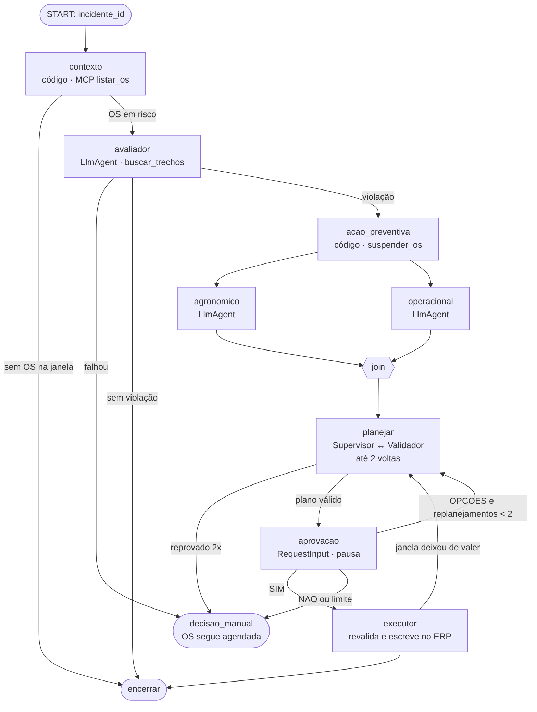

# TerraMind · Agentes e integração (frente do Gustavo) — Implementation Plan

> **For agentic workers:** REQUIRED SUB-SKILL: Use superpowers:subagent-driven-development (recommended) or superpowers:executing-plans to implement this plan task-by-task. Steps use checkbox (`- [ ]`) syntax for tracking.

**Goal:** Entregar o serviço `agents`, que recebe o incidente aberto pelo Monitor, avalia o risco das OS na janela, suspende o que viola, monta e valida um plano de reagendamento, pede aprovação ao gerente, retoma a sessão quando o callback chega (mesmo horas depois ou após um restart) e executa o plano no ERP.

**Architecture:** Um processo FastAPI (`agents`, porta 8000) que hospeda o `Runner` do ADK, o bot do Telegram em long polling e uma tarefa de timeout. O fluxo é um `Workflow` do ADK 2.x: nós em código para Contexto, Ação Preventiva, Validador, Aprovação e Executor; quatro `LlmAgent` (Avaliador, Agronômico, Operacional, Supervisor) na API da OpenAI (`openai/gpt-4o-mini`). A aprovação pausa com `RequestInput` e retoma com uma `FunctionResponse` na mesma sessão do `DatabaseSessionService` (Postgres, schema `agente`). O ERP é acessado pelo MCP do Felipe; o conhecimento, pela API do Edison.

**Tech Stack:** Python 3.12, uv, `google-adk[db]` 2.13+, `litellm>=1.84` (OpenAI), `mcp` (cliente streamable HTTP), FastAPI, Pydantic v2 + pydantic-settings, SQLAlchemy 2 async + asyncpg, httpx, pytest + pytest-asyncio, respx, testcontainers, ruff.

**Spec:** "Arquitetura para desenvolvimento" (27/10/2026) com as decisões A1–A7 de [docs/contratos.md](../contratos.md). Seções usadas: Agentes e nós, Fluxo do agente, Modelo de dados (schema `agente`), Riscos.

## Estado da implementação (29/10)

Conferido contra https://adk.dev/workflows/ e as páginas de grafos (rotas, dados, dinâmico, entrada humana, colaboração): imports pelo caminho da doc (`from google.adk import Workflow, Event, Context`; `JoinNode`/`node` de `google.adk.workflow`; `RequestInput` de `google.adk.events`), rotas por `Event(route=...)` com dicionário nas arestas, `JoinNode` com todos os predecessores emitindo output, laços limitados em código e agentes em `single_turn`.

Todas as tarefas (1 a 17) estão implementadas em `agents/`, na branch `feat/agents`. São 67 testes; os 4 com Postgres usam testcontainers. Também rodou um teste de fumaça com containers: imagem do `agents` + Postgres, `/iniciar` levando o incidente a `aguardando_decisao_manual` quando o ERP está fora. Onde o código difere do texto abaixo:

| Ponto | Plano | Implementado | Por quê |
| --- | --- | --- | --- |
| LLMs no grafo | `LlmAgent` como nó direto | Os quatro `Agent` são nós do grafo (`mode="single_turn"`), cada um seguido de um nó em código que roteia (`rota_avaliacao`, `validador`). `on_model_error_callback` e `after_model_callback` (`agentes/_comum.protecoes`) transformam erro do modelo ou saída fora do schema numa marca `falha_<agente>` no estado; timeout e novas tentativas ficam no cliente LiteLLM. Todo roteador tem `DEFAULT_ROUTE` → `decisao_manual` | Uma exceção num nó `Agent` derrubaria o workflow inteiro; assim a falha vira rota (`falhou`, decisão A5) e os agentes aparecem no grafo do `adk web` |
| `interrupt_id` da aprovação | — | Explícito: `aprovacao:{plano_id}` | Os exemplos Python da doc usam o id implícito; o campo existe em `RequestInput` e o callback do Telegram precisa de um id previsível |
| Ferramentas de ERP dos LLMs | `McpToolset` com `tool_filter` | Funções em `agents/ferramentas.py` sobre o mesmo `ErpCliente` dos nós | Mesmo dado e mesma conexão MCP; os testes trocam por fakes; o LLM só vê leituras |
| `agents/tools/conhecimento.py` (Task 11 do Edison) | PR do Edison | `clientes/conhecimento.py` + `ferramentas.criar_buscar_trechos` | O Avaliador precisava dela já; o Edison só precisa garantir o formato da API (contratos 10 e 11) |
| Pedido de aprovação | O `Orquestrador` envia ao ver o evento | O nó `aprovacao` muda o status e envia antes de emitir o `RequestInput` | Um lugar só; o nó não roda de novo na retomada (`rerun_on_resume=False`) |
| Plano B da Task 5 | Sessão nova se a retomada falhar | Não foi preciso | `test_retoma_sessao_em_orquestrador_novo` passa com `DatabaseSessionService` em Postgres |
| `channels/` do Felipe | Dependência por caminho | Import opcional em `agents/canal.py`; sem o pacote, `CanalLog` | O pacote ainda não existe; ver contrato 7 |
| `mcp` | sem versão | `mcp>=1.24,<2` | A 2.x mudou a API do cliente e do `FastMCP`; o plano do Felipe usa a 1.x |
| Arquivos a mais | — | `deps.py`, `agentes/<agente>/agent.py` (uma pasta por agente, padrão do ADK), `ferramentas.py`, `canal.py`, `rules/{validador,mensagem,previsao}.py`, `verificar_modelos.py` | Injeção de dependências, prompts e regras puras separadas para teste |

Ainda depende de ação humana:
- rodar `uv run python -m agents.verificar_modelos` com `OPENAI_API_KEY` para confirmar o `gpt-4o-mini` (tools + `output_schema`);
- ensaiar os prompts com os trechos reais do Edison (Task 17).

## Global Constraints

- O `Workflow` é a única composição. Nada de `SequentialAgent`, `ParallelAgent` ou `LoopAgent` (descontinuados no ADK 2.13).
- A única escrita sem aprovação é `suspender_os`. `reagendar_os`, `alocar_maquina` e `reservar_estoque` só rodam depois de um `SIM` gravado em `agente.planos`.
- Todo valor em R$ vem de `calcular_impacto` em código: `area_ha × dose_por_ha × preco_unitario × fator`. O texto do Supervisor nunca é a fonte do número: o rodapé da mensagem com perda e citação é montado em código.
- O Avaliador é LLM e decide a violação (A4). O que ele devolve é tratado como dado: validado por schema Pydantic, gravado na auditoria com o trecho e a página citados. Se ele falhar, a OS **não** é suspensa (A5).
- `interrupt_id` da aprovação = `f"aprovacao:{plano_id}"`. `session_id` = `f"incidente-{incidente_id}"`. `user_id` = `"terramind"`. `app_name` = `"terramind"`.
- Clientes de serviços externos (MCP, conhecimento, canal) ficam atrás de um `Protocol` com um fake em memória. Nenhum teste unitário fala com rede ou LLM real.
- Ferramentas expostas a LLM nunca levantam exceção: devolvem `{"ok": False, "erro": ...}`.
- Unidades e fuso do contrato 12. Todo `datetime` com fuso `America/Sao_Paulo`.
- No Windows, `PYTHONUTF8=1` (exigência do LiteLLM). Não instalar `litellm` 1.82.7 nem 1.82.8 (versões comprometidas, aviso do ADK).
- Commits em Conventional Commits, em português e no imperativo. Escopos: `agents`, `rules`, `nodes`, `api`, `infra`, `docs`.

## Contratos que esta frente depende

Ver [docs/contratos.md](../contratos.md). Os que bloqueiam código:

| Contrato | O que eu preciso | Até quando | Sem ele, eu uso |
|---|---|---|---|
| 3 | `POST /incidentes/{id}/iniciar` e `previsao_snapshot` com 120 h | dia 1 | `FakeMonitor` que faz o INSERT nos testes |
| 5 | Nomes e formato `{"ok": ...}` das ferramentas MCP | dia 1 | `FakeErp` com os mesmos nomes |
| 6, 7 | `Resposta`, `ao_responder`, `criar_canal`, `iniciar()` | dia 2 | `FakeCanal` que grava as mensagens numa lista |
| 8, 9 | `agente.planos` com `criado_em`/`escalado_em`; `search_path=agente` | dia 2 | `tests/sql/contrato_minimo_agente.sql` |
| 10, 11 | `buscar_trechos` e `GET /fatores-perda` | dia 3 | `FakeConhecimento` |

## Review Focus

1. **Retomada após restart:** o callback chega num `Runner` novo, em outro processo, e a sessão continua do nó de aprovação → teste com Postgres na Task 5 (é o maior risco técnico do projeto, por isso fica no dia 2).
2. **Clique duplo / resposta repetida:** o segundo SIM não reagenda de novo → `UPDATE ... WHERE respondido_em IS NULL RETURNING` e teste na Task 6.
3. **Laço sem fim:** Supervisor↔Validador limitado a 2 voltas e Ver opções limitado a 2 re-planejamentos → testes nas Tasks 12 e 13.
4. **Avaliador falhou:** a OS segue `agendada`, o gerente é alertado e o incidente vai para `aguardando_decisao_manual` → teste na Task 9.
5. **SIM atrasado:** a janela aprovada pode ter deixado de valer; o Executor revalida antes de escrever → teste na Task 14.
6. **Número sem fonte:** a perda em R$ e a citação no rodapé da mensagem vêm do estado, não do texto do LLM → teste na Task 12.

---

## Fluxogramas

### 1. O grafo do incidente



### 2. Pausa e retomada

```mermaid
sequenceDiagram
    participant M as Monitor (Edison)
    participant A as agents (FastAPI)
    participant R as Runner ADK
    participant DB as Postgres (agente.*)
    participant T as Telegram (Felipe)
    M->>DB: INSERT incidentes (aberto)
    M->>A: POST /incidentes/7/iniciar
    A->>R: run_async(session "incidente-7", new_message)
    R->>DB: eventos da sessão
    R-->>A: evento adk_request_input id="aprovacao:12"
    A->>DB: incidente → aguardando_aprovacao
    A->>T: pedir_aprovacao(7, 12, texto)
    Note over A,R: invocação termina; processo pode reiniciar
    T->>A: ao_responder(7, 12, SIM)
    A->>DB: UPDATE planos SET respondido_em ... WHERE respondido_em IS NULL
    A->>R: run_async(new_message = FunctionResponse(name="adk_request_input", id="aprovacao:12"))
    R->>DB: carrega sessão, acha a invocação pausada
    R-->>A: executor roda, incidente → encerrado
```

### 3. Estado da sessão (chaves)

| Chave | Quem escreve | Conteúdo |
|---|---|---|
| `incidente` | contexto | `Incidente` (id, talhão, gatilhos, snapshot) |
| `os_em_risco` | contexto | `list[OsEmRisco]` |
| `avaliacao` | avaliador (`output_key`) | `AvaliacaoRisco` |
| `os_suspensas` | acao_preventiva | `list[int]` |
| `impactos` | acao_preventiva | `list[Impacto]` (R$ por OS) |
| `analise_agronomica` | agronomico (`output_key`) | texto com citação |
| `analise_operacional` | operacional (`output_key`) | texto |
| `plano` | planejar | `PlanoProposto` validado + `plano_id` |
| `motivo_reprovacao` | validador | texto ou ausente |
| `replanejamentos` | aprovacao | int |

---

## Mapa de arquivos

```
agents/
├── pyproject.toml                 # depende de channels/ (path, editable)
├── Dockerfile
├── agents/
│   ├── config.py                  # Settings
│   ├── modelos.py                 # Pydantic: Incidente, OsEmRisco, AvaliacaoRisco, Impacto, OpcaoPlano, PlanoProposto, Veredito
│   ├── llm.py                     # modelo_para(agente) -> LiteLlm
│   ├── clientes/
│   │   ├── erp.py                 # ErpCliente (Protocol), ErpMcp, FakeErp
│   │   ├── conhecimento.py        # ConhecimentoCliente (Protocol), ConhecimentoHttp, FakeConhecimento
│   │   └── repositorio.py         # RepositorioAgente: incidentes, planos (SQL)
│   ├── rules/
│   │   ├── impacto.py             # calcular_impacto
│   │   └── janelas.py             # janelas_validas
│   ├── nodes/
│   │   ├── contexto.py
│   │   ├── avaliador.py           # LlmAgent + output_schema
│   │   ├── acao_preventiva.py
│   │   ├── especialistas.py       # agronomico, operacional
│   │   ├── planejar.py            # supervisor (LlmAgent) + validador + laço
│   │   ├── aprovacao.py           # RequestInput + roteamento
│   │   ├── executor.py
│   │   └── desfechos.py           # encerrar, decisao_manual
│   ├── tools/
│   │   └── conhecimento.py        # consultar_regras, buscar_trechos (PR do Edison, Task 11 dele)
│   ├── workflow.py                # monta o Workflow e o App
│   ├── runner.py                  # iniciar_incidente, responder, retomar
│   ├── timeout.py                 # escalonamento de planos sem resposta
│   └── api.py                     # FastAPI: /health, /incidentes/{id}/iniciar, /incidentes/{id}/resposta
└── tests/
    ├── fakes.py                   # FakeErp, FakeConhecimento, FakeCanal, FakeLlm
    ├── sql/contrato_minimo_agente.sql
    └── test_*.py
```

Testes: `cd agents && uv run pytest -v`. Os que precisam de Postgres usam `testcontainers` (`postgres:16`) e aplicam `db/migrations/*.sql` em ordem; enquanto as do Felipe não existirem, aplicam `tests/sql/contrato_minimo_agente.sql`. Os LLMs são trocados por um `FakeLlm(BaseLlm)` que devolve respostas roteirizadas (há um `MockModel` de referência em `google/adk/cli/agent_test_runner.py`).

---

## Fase 1 — Esqueleto (branch `feat/agents-base`, dia 1)

### Task 1: Pacote `agents`, configuração e health check

**Files:**
- Create: `agents/pyproject.toml`, `agents/agents/config.py`, `agents/agents/api.py`, `agents/tests/test_health.py`

**Interfaces:**
- Produces: `Settings` (pydantic-settings) com `database_url`, `erp_mcp_url`, `conhecimento_url`, `openai_api_key`, `model_avaliador`, `model_agronomico`, `model_operacional`, `model_supervisor`, `channel: Literal["telegram","painel"] = "painel"`, `telegram_bot_token: str | None`, `gerente_chat_id: int | None`, `approval_timeout_min: int = 30`, `max_replanejamentos: int = 2`, `max_voltas_validador: int = 2`, `timeout_llm_s: float = 60`. `app: FastAPI` com `GET /health` → `{"status": "ok"}`.

- [ ] **Step 1:** teste `test_health` → FAIL
- [ ] **Step 2:** `uv init --package agents`; dependências: `google-adk[db]>=2.13`, `litellm>=1.84`, `mcp`, `fastapi`, `uvicorn[standard]`, `pydantic-settings`, `sqlalchemy[asyncio]`, `asyncpg`, `httpx`; dev: `pytest`, `pytest-asyncio`, `respx`, `testcontainers[postgres]`, `ruff`
- [ ] **Step 3:** `uv run pytest -v && uv run ruff check .` → PASS
- [ ] **Step 4:** `git commit -m "feat(agents): cria serviço com configuração e health check"`

### Task 2: Modelos, clientes e fakes

**Files:**
- Create: `agents/agents/modelos.py`, `agents/agents/clientes/erp.py`, `agents/agents/clientes/conhecimento.py`, `agents/tests/fakes.py`, `agents/tests/test_modelos.py`

**Interfaces:**
- Produces:
  - `OsEmRisco`: `os_id, talhao_id, talhao, area_ha, cultura, estagio, tipo_operacao, insumo_id, produto, tipo_insumo, dose_por_ha, unidade, preco_unitario, inicio_previsto, duracao_horas, maquina_id, operador_id`.
  - `ViolacaoOs`: `os_id, viola: bool, parametro: Literal["chuva","vento","umidade","temperatura"] | None, limite: float | None, unidade: str | None, janela_h: float | None, valor_previsto: float | None, trecho: str | None, fonte_doc: str | None, pagina: int | None, justificativa: str`. Validador Pydantic: `viola=True` exige `parametro`, `limite`, `fonte_doc` e `pagina`; faixas de unidade (vento em km/h ≤ 200, chuva em mm ≤ 500).
  - `AvaliacaoRisco`: `violacoes: list[ViolacaoOs]`.
  - `Impacto`: `os_id, area_ha, dose_por_ha, preco_unitario, fator, fonte_fator, perda_rs`.
  - `OpcaoPlano`: `os_id, novo_inicio: AwareDatetime, maquina_id, justificativa`. `PlanoProposto`: `opcoes: list[OpcaoPlano]` (uma por OS suspensa), `mensagem: str`.
  - `Veredito`: `aprovado: bool, motivos: list[str]`.
  - `class ErpCliente(Protocol)`: `listar_os`, `detalhar_os`, `consultar_talhao`, `disponibilidade_maquinas`, `listar_operadores`, `suspender_os`, `reagendar_os`, `alocar_maquina`, `reservar_estoque`, com os parâmetros da seção 7.3 do plano do Felipe, todos `async` e devolvendo `dict`.
  - `ErpMcp(url)`: implementa o Protocol com `mcp.client.streamable_http.streamablehttp_client` + `ClientSession.call_tool`, e lê `structuredContent` ou o JSON do primeiro `TextContent`.
  - `class ConhecimentoCliente(Protocol)`: `buscar_trechos(consulta, produto=None, secao=None) -> dict`, `fator_perda(tipo_insumo, condicao) -> dict | None`. `ConhecimentoHttp(url)` com timeout de 5 s.
  - `FakeErp`, `FakeConhecimento`, `FakeCanal` (grava `alertas`, `aprovacoes`, `operadores` em listas).

- [ ] **Step 1: Testes que falham**

```python
def test_violacao_exige_citacao():
    with pytest.raises(ValidationError):
        ViolacaoOs(os_id=1, viola=True, parametro="chuva", limite=30, justificativa="x")

def test_fake_erp_suspende_uma_vez(fake_erp_com_os):
    assert (await fake_erp_com_os.suspender_os(1, 7, "chuva"))["ok"] is True
    assert (await fake_erp_com_os.suspender_os(1, 7, "chuva"))["ok"] is False
```

- [ ] **Step 2:** `uv run pytest tests/test_modelos.py -v` → FAIL
- [ ] **Step 3:** Implementar. O `FakeErp` reproduz as transições de status do `CHECK` do Felipe.
- [ ] **Step 4:** `uv run pytest -v` → PASS
- [ ] **Step 5:** `git commit -m "feat(agents): adiciona modelos de estado, clientes de ERP e conhecimento e fakes"`

### Task 3: `Workflow` com nós vazios rodando até a pausa

**Files:**
- Create: `agents/agents/workflow.py`, `agents/agents/llm.py`, `agents/agents/nodes/*.py` (stubs), `agents/tests/test_workflow_esqueleto.py`

**Interfaces:**
- Produces:
  - `modelo_para(nome: Literal["avaliador","agronomico","operacional","supervisor"]) -> LiteLlm` (lê `Settings.model_<nome>`; formato `openai/<modelo>`).
  - `criar_workflow(deps: Dependencias) -> Workflow`, em que `Dependencias` agrupa `erp`, `conhecimento`, `canal`, `repo`, `settings` e `modelos: dict[str, BaseLlm]` (injetável nos testes).
  - `criar_app(deps) -> App` com `ResumabilityConfig(is_resumable=True)`.
  - Arestas (sintaxe de `google.adk.workflow`): `("START", contexto)`, `(contexto, {"sem_os": encerrar, "com_os": avaliador})`, `(avaliador, rota_avaliacao)`, `(rota_avaliacao, {"falhou": decisao_manual, "sem_violacao": encerrar, "violacao": acao_preventiva})`, `(acao_preventiva, agronomico, join)`, `(acao_preventiva, operacional, join)`, `(join, planejar)`, `(planejar, {"valido": aprovacao, "reprovado": decisao_manual})`, `(aprovacao, rota_resposta)`, `(rota_resposta, {"SIM": executor, "OPCOES": planejar, "NAO": decisao_manual})`, `(executor, {"ok": encerrar, "revalidar": planejar})`.

- [ ] **Step 1: Teste que falha**: com stubs e `InMemorySessionService`, `run_async` emite um evento cujo `function_call.name == "adk_request_input"` e `id == "aprovacao:1"`.
- [ ] **Step 2:** `uv run pytest tests/test_workflow_esqueleto.py -v` → FAIL
- [ ] **Step 3:** Implementar o grafo com stubs que só escrevem chaves fixas no estado.
- [ ] **Step 4:** `uv run pytest -v` → PASS
- [ ] **Step 5:** `git commit -m "feat(agents): monta o workflow do incidente com nós vazios"`

**Fim da fase:** PR `feat/agents-base`. Junto, abrir `docs/contratos.md` para o ok do Edison e do Felipe.

---

## Fase 2 — Sessão, pausa e retomada (branch `feat/agents-retomada`, dia 2)

### Task 4: Repositório do schema `agente`

**Files:**
- Create: `agents/agents/clientes/repositorio.py`, `agents/tests/sql/contrato_minimo_agente.sql`, `agents/tests/test_repositorio.py`

**Interfaces:**
- Produces `RepositorioAgente(engine: AsyncEngine)`:
  - `carregar_incidente(id) -> Incidente | None`;
  - `mudar_status(id, de: set[str], para: str) -> bool`, com `UPDATE ... WHERE status = ANY(:de)`;
  - `criar_plano(incidente_id, plano: PlanoProposto) -> int`;
  - `registrar_resposta(plano_id, resposta, respondido_por) -> bool`, com `UPDATE ... WHERE id = :id AND respondido_em IS NULL RETURNING id`. Grava `aprovado_por` só quando a resposta é `SIM`;
  - `pendentes_para_escalar(agora, timeout_min) -> list[tuple[int, int]]` e `marcar_escalado(plano_id)`;
  - `auditar(incidente_id, no, acao, antes, depois, justificativa)`.

- [ ] **Step 1: Testes que falham** (Postgres): resposta repetida devolve `False`; `NAO` não preenche `aprovado_por`; transição de status inválida devolve `False`.
- [ ] **Step 2–4:** FAIL → implementar → PASS
- [ ] **Step 5:** `git commit -m "feat(agents): adiciona repositório de incidentes e planos"`

### Task 5: Runner com retomada após restart

**Files:**
- Create: `agents/agents/runner.py`, `agents/tests/test_retomada_pg.py`

**Interfaces:**
- Produces:
  - `criar_session_service(database_url) -> DatabaseSessionService`, que troca `postgresql://` por `postgresql+asyncpg://` e passa `connect_args={"server_settings": {"search_path": "agente"}}` (o ADK repassa os kwargs para `create_async_engine`).
  - `class Orquestrador(app, session_service, repo, canal)`:
    - `iniciar(incidente_id) -> None`: cria a sessão `incidente-{id}` se não existir (se existir, retorna sem rodar de novo) e roda `run_async` com `new_message` contendo o `incidente_id`. Ao ver o evento `adk_request_input`, muda o incidente para `aguardando_aprovacao` e chama `canal.pedir_aprovacao(incidente_id, plano_id, texto)` com o `payload` do `RequestInput`;
    - `responder(r: Resposta) -> Literal["ok","repetida","desconhecida"]`: chama `repo.registrar_resposta` e, se gravou, roda `run_async(new_message=Content(role="user", parts=[Part(function_response=FunctionResponse(id=f"aprovacao:{r.plano_id}", name="adk_request_input", response={"resposta": r.resposta, "respondido_por": r.respondido_por}))]))`. O `invocation_id` é inferido pelo runner a partir dos eventos da sessão.

- [ ] **Step 1: Teste que falha** (o teste que justifica o dia 2):

```python
async def test_retoma_em_runner_novo(pg_url, deps_fake):
    o1 = Orquestrador(criar_app(deps_fake), criar_session_service(pg_url), ...)
    await o1.iniciar(7)
    assert deps_fake.canal.aprovacoes == [(7, 1)]
    del o1                                        # simula restart
    o2 = Orquestrador(criar_app(deps_fake), criar_session_service(pg_url), ...)
    assert await o2.responder(Resposta(7, 1, "SIM", "gerente")) == "ok"
    assert deps_fake.erp.status(1) == "reagendada"

async def test_resposta_repetida(pg_url, deps_fake):
    ...
    assert await o.responder(Resposta(7, 1, "SIM", "gerente")) == "repetida"
```

- [ ] **Step 2:** `uv run pytest tests/test_retomada_pg.py -v` → FAIL
- [ ] **Step 3:** Implementar. Se a retomada pela `FunctionResponse` falhar com o `DatabaseSessionService`, aplicar o plano B da spec: o `plano` já está em `agente.planos`, e o callback abre uma sessão nova `incidente-{id}-r{n}` que começa no nó `rota_resposta` com o estado copiado. Registrar a escolha em `docs/contratos.md`.
- [ ] **Step 4:** `uv run pytest -v` → PASS
- [ ] **Step 5:** `git commit -m "feat(agents): retoma a sessão do incidente pela resposta do gerente"`

### Task 6: API HTTP e canal no lifespan

**Files:**
- Modify: `agents/agents/api.py`
- Create: `agents/tests/test_api.py`

**Interfaces:**
- Consumes: contratos 3, 6 e 7.
- Produces:
  - `POST /incidentes/{id}/iniciar` → 202 e roda `Orquestrador.iniciar` numa `asyncio.Task` guardada em `app.state`; incidente inexistente → 404.
  - `POST /incidentes/{id}/resposta` com corpo `{"plano_id": int, "resposta": "SIM"|"NAO"|"OPCOES", "respondido_por": str}` → 200 `ok` · 409 `repetida` · 404 `desconhecida`.
  - Lifespan: `canal = criar_canal(settings.channel, orquestrador.responder)`; se for Telegram, `await canal.iniciar()`; na saída, para o polling.

- [ ] **Step 1: Testes que falham**: iniciar devolve 202; resposta repetida devolve 409; corpo com `resposta="TALVEZ"` devolve 422.
- [ ] **Step 2–4:** FAIL → implementar → PASS
- [ ] **Step 5:** `git commit -m "feat(api): expõe início de incidente e resposta do gerente"`
- [ ] **Step 6 (com o Felipe):** clicar SIM no Telegram de verdade faz a sessão continuar. **Pronto quando** o clique chega a `responder` e o log mostra o nó `executor` rodando.

**Fim da fase:** PR `feat/agents-retomada`.

---

## Fase 3 — Contexto, avaliação e suspensão (branch `feat/agents-avaliacao`, dias 2–3)

### Task 7: Nó Contexto

**Files:** `agents/agents/nodes/contexto.py`, `agents/tests/test_contexto.py`

**Interfaces:**
- Consumes: `repo.carregar_incidente`, `erp.listar_os(inicio, fim, talhao_id)`.
- Produces: função de nó que lê o incidente, calcula a janela de risco (`min(gatilho.inicio)` até `max(gatilho.fim)`), lista as OS `agendada` do talhão nessa janela e escreve `incidente` e `os_em_risco` no estado. Rota `com_os` ou `sem_os`.

- [ ] **Step 1:** testes: OS fora da janela é ignorada; OS já `suspensa_preventiva` é ignorada; nenhuma OS → rota `sem_os`.
- [ ] **Step 2–4:** FAIL → implementar → PASS
- [ ] **Step 5:** `git commit -m "feat(nodes): busca as OS agendadas na janela de risco"`

### Task 8: `calcular_impacto`

**Files:** `agents/agents/rules/impacto.py`, `agents/tests/test_impacto.py`

**Interfaces:**
- Produces: `calcular_impacto(os: OsEmRisco, condicao: str, conhecimento) -> Impacto`. O `fator` vem de `GET /fatores-perda?tipo_insumo=&condicao=` (contrato 11). Sem fator → `fator=None`, `perda_rs=None` e `fonte_fator="sem fator cadastrado"`: o número não é inventado.
- Também exposta como ferramenta do Supervisor (`calcular_impacto(os_id: int, condicao: str) -> dict`).

- [ ] **Step 1:** testes: `120 ha × 200 kg/ha × R$ 3,20 × 0,3 = R$ 23.040,00`; sem fator → `perda_rs is None`.
- [ ] **Step 2–4:** FAIL → implementar com `Decimal` e arredondamento a centavos → PASS
- [ ] **Step 5:** `git commit -m "feat(rules): calcula a perda em reais a partir do ERP e do fator citado"`

### Task 9: Avaliador de Risco (LLM)

**Files:** `agents/agents/nodes/avaliador.py`, `agents/tests/test_avaliador.py`

**Interfaces:**
- Produces:
  - `LlmAgent(name="avaliador", model=modelos["avaliador"], tools=[buscar_trechos], output_schema=AvaliacaoRisco, output_key="avaliacao", include_contents="none")`. A instrução recebe `{os_em_risco}` e um resumo da previsão (chuva acumulada por janela de 6 h, vento máximo, umidade mínima e temperatura, calculados em código a partir do snapshot). Pede uma `ViolacaoOs` por OS, buscando o trecho da bula ou da referência filtrado por `produto` e citando `fonte_doc` e `pagina` do trecho recuperado.
  - Envolvido em `node(..., timeout=settings.timeout_llm_s)`.
  - `rota_avaliacao`: exceção, timeout, schema inválido ou nenhuma violação com citação → `falhou`; nenhuma `viola=True` → `sem_violacao`; pelo menos uma → `violacao`. Em `falhou`, chama `canal.enviar_alerta("Não consegui avaliar o risco das OS X, Y. Elas continuam agendadas; verifique.")`, grava a auditoria e muda o incidente para `aguardando_decisao_manual` (A5).

- [ ] **Step 1:** testes com `FakeLlm`: resposta roteirizada com violação → rota `violacao` e `avaliacao` no estado; LLM levanta erro → rota `falhou`, `FakeErp` sem suspensão e um alerta no `FakeCanal`; JSON fora do schema → `falhou`.
- [ ] **Step 2–4:** FAIL → implementar → PASS
- [ ] **Step 5:** `git commit -m "feat(nodes): avalia o risco das OS com base nos trechos citados"`

### Task 10: Ação Preventiva

**Files:** `agents/agents/nodes/acao_preventiva.py`, `agents/tests/test_acao_preventiva.py`

**Interfaces:**
- Produces: para cada `ViolacaoOs` com `viola=True`, chama `erp.suspender_os(os_id, incidente_id, motivo)`, em que `motivo` = justificativa + `fonte_doc` p. `pagina`. Depois calcula `calcular_impacto(os, parametro)`. Escreve `os_suspensas` e `impactos`. Uma OS que devolve `ok: false` (já suspensa) não interrompe as outras e entra na auditoria.

- [ ] **Step 1:** testes: duas violações → duas suspensões; uma OS já suspensa → a outra é suspensa mesmo assim.
- [ ] **Step 2–4:** FAIL → implementar → PASS
- [ ] **Step 5:** `git commit -m "feat(nodes): suspende preventivamente as OS que violam a avaliação"`

**Fim da fase:** PR `feat/agents-avaliacao`. **Marco do dia 3:** com fakes no lugar dos LLMs, o fluxo vai de incidente a OS amarela a pedido de aprovação a SIM a OS azul.

---

## Fase 4 — Especialistas, plano e aprovação (branch `feat/agents-plano`, dias 3–4)

### Task 11: `janelas_validas`

**Files:** `agents/agents/rules/janelas.py`, `agents/tests/test_janelas.py`

**Interfaces:**
- Produces: `janelas_validas(horas: list[HoraPrevisao], violacao: ViolacaoOs, duracao_h: float, ocupacoes: list[tuple[datetime, datetime]], agora, max_opcoes=3) -> list[datetime]`. Um início `t` (hora cheia, entre 06:00 e 18:00, a partir de `agora + 2 h`) é válido quando:
  - o parâmetro violado respeita o limite no intervalo que o próprio limite define. Para chuva, a soma em `[t, t + janela_h]` fica ≤ `limite`. Para vento, umidade e temperatura, cada hora de `[t, t + duracao_h]` fica dentro do limite;
  - `[t, t + duracao_h]` não sobrepõe nenhuma ocupação da máquina;
  - toda a janela cabe no snapshot (sem extrapolar além de 120 h).
- Também exposta como ferramenta do Operacional e do Supervisor (`janelas_validas(os_id: int) -> dict`), que busca horas e violação no estado e as ocupações via `erp.disponibilidade_maquinas`.

- [ ] **Step 1:** testes: chuva de 80 mm nas primeiras 36 h → primeira janela depois da chuva; máquina ocupada empurra para a próxima; snapshot curto demais → lista vazia.
- [ ] **Step 2–4:** FAIL → implementar → PASS
- [ ] **Step 5:** `git commit -m "feat(rules): calcula as próximas janelas válidas de aplicação"`

### Task 12: Agronômico, Operacional, Supervisor e Validador

**Files:** `agents/agents/nodes/especialistas.py`, `agents/agents/nodes/planejar.py`, `agents/tests/test_planejar.py`

**Interfaces:**
- Produces:
  - `agronomico`: `LlmAgent(tools=[buscar_trechos, consultar_talhao], output_key="analise_agronomica")`. Interpreta o risco para a cultura e o estágio e cita fonte e página.
  - `operacional`: `LlmAgent(tools=[listar_os, disponibilidade_maquinas, listar_operadores, janelas_validas], output_key="analise_operacional")`. As ferramentas de ERP entram por `McpToolset(connection_params=StreamableHTTPConnectionParams(url=ERP_MCP_URL), tool_filter=[...])`, só leitura.
  - Os dois saem de `acao_preventiva` e chegam a um `JoinNode`.
  - `supervisor`: `LlmAgent(tools=[calcular_impacto, janelas_validas], output_schema=PlanoProposto)`. Lê as duas análises, `impactos` e `motivo_reprovacao`, e propõe uma opção por OS suspensa, com a mensagem ao gerente.
  - `validar(plano, estado, erp) -> Veredito` (código puro). Para cada opção, confere se `novo_inicio ∈ janelas_validas(...)` com o limite de `avaliacao` (A4: o limite vem do LLM, sem conferência contra tabela), se a máquina está livre via `disponibilidade_maquinas` e se `os_id ∈ os_suspensas`.
  - `planejar`: nó dinâmico (`@node(rerun_on_resume=True)`) que chama `ctx.run_node(supervisor)` e `validar` até `max_voltas_validador` vezes, alimentando `motivo_reprovacao`. Se passar: `repo.criar_plano` → `plano_id`, e a mensagem final vira o texto do Supervisor mais um rodapé montado em código (perda em R$ de `impactos`, citação de `avaliacao`, nova data de `opcoes`). Rota `valido` ou `reprovado`.

- [ ] **Step 1:** testes: Supervisor fake propõe janela inválida e depois válida → `valido` com 2 chamadas; inválida duas vezes → `reprovado`; o rodapé contém `R$ 23.040,00` mesmo que o texto do LLM diga outro valor.
- [ ] **Step 2–4:** FAIL → implementar → PASS
- [ ] **Step 5:** `git commit -m "feat(nodes): concilia as análises num plano validado em código"`

### Task 13: Aprovação e roteamento da resposta

**Files:** `agents/agents/nodes/aprovacao.py`, `agents/agents/nodes/desfechos.py`, `agents/tests/test_aprovacao.py`

**Interfaces:**
- Produces:
  - `aprovacao`: nó função (`rerun_on_resume=False`) que emite `RequestInput(interrupt_id=f"aprovacao:{plano_id}", message=texto, payload={"incidente_id", "plano_id"}, response_schema=RespostaGerente)`. A resposta vira a entrada de `rota_resposta`.
  - `rota_resposta`: `SIM` → `executor`; `OPCOES` com `replanejamentos < max_replanejamentos` → incrementa e volta a `planejar` (o Supervisor recebe "o gerente pediu outra opção; exclua {datas já oferecidas}"); `NAO`, ou `OPCOES` no limite → `decisao_manual`.
  - `decisao_manual`: incidente → `aguardando_decisao_manual`, alerta ao gerente ("OS X segue suspensa; decida no painel"), auditoria.
  - `encerrar`: incidente → `encerrado`, auditoria.

- [ ] **Step 1:** testes: `OPCOES` duas vezes gera planos 2 e 3, e a terceira vai para `decisao_manual`; `NAO` mantém a OS `suspensa_preventiva`.
- [ ] **Step 2–4:** FAIL → implementar → PASS
- [ ] **Step 5:** `git commit -m "feat(nodes): pausa para aprovação e roteia SIM, NÃO e ver opções"`

**Fim da fase:** PR `feat/agents-plano`. **Marco do dia 4:** os quatro LLMs reais da OpenAI, ponta a ponta, com o replay do Edison.

---

## Fase 5 — Execução e timeout (branch `feat/agents-executor`, dia 5)

### Task 14: Executor

**Files:** `agents/agents/nodes/executor.py`, `agents/tests/test_executor.py`

**Interfaces:**
- Produces: revalida o plano com `validar` (para o SIM atrasado). Se a janela deixou de valer, rota `revalidar` e alerta "a janela aprovada não vale mais; preparando nova opção". Se vale, para cada opção:
  - `reagendar_os(os_id, novo_inicio, plano_id)`;
  - `alocar_maquina(...)`, se a máquina mudou;
  - `reservar_estoque(insumo_id, area_ha × dose_por_ha, plano_id)`;
  - `canal.notificar_operador(chat_id, texto)`.
- Falha em qualquer escrita → para, alerta e vai para `decisao_manual`. Fim normal → rota `ok`.

- [ ] **Step 1:** testes: SIM → OS `reagendada` e estoque baixado; SIM com chuva nova no snapshot → `revalidar`; `reservar_estoque` devolve `ok: false` → `decisao_manual`.
- [ ] **Step 2–4:** FAIL → implementar → PASS
- [ ] **Step 5:** `git commit -m "feat(nodes): executa o plano aprovado no ERP e avisa o operador"`

### Task 15: Timeout e escalonamento

**Files:** `agents/agents/timeout.py`, `agents/tests/test_timeout.py`, Modify: `agents/agents/api.py` (lifespan)

**Interfaces:**
- Produces: `verificar_timeouts(repo, canal, agora, timeout_min) -> list[int]`: para cada plano sem resposta há mais de `timeout_min` e ainda não escalado, envia `enviar_alerta("Sem resposta há N min: OS X segue suspensa")`, grava `escalado_em` e a auditoria. A sessão continua pausada, e um SIM tardio é aceito (a Task 14 revalida). O lifespan roda essa verificação a cada 60 s numa `asyncio.Task`.

- [ ] **Step 1:** testes: escalona uma vez só; plano respondido não escalona.
- [ ] **Step 2–4:** FAIL → implementar → PASS
- [ ] **Step 5:** `git commit -m "feat(agents): escalona aprovações sem resposta"`

---

## Fase 6 — Container, prompts e bordas (branch `chore/agents-infra`, dias 5–6)

### Task 16: Dockerfile, compose e README

- `agents/Dockerfile` no padrão do Felipe (seção 10), com `CMD ["uv", "run", "uvicorn", "agents.api:app", "--host", "0.0.0.0", "--port", "8000"]`.
- Bloco `agents` no `docker-compose.yml`, com `depends_on` em `postgres` (healthy), `erp-mcp` e `conhecimento`.
- Seção do README: inputs, lógica e outputs por etapa (tabela da spec atualizada), com o grafo da seção 1 deste plano.
- `git commit -m "chore(infra): adiciona o serviço agents ao compose"`

### Task 17: Prompts e casos de borda

- Estabilizar as instruções dos quatro agentes com o cenário de replay (dia 5), rodando 5 vezes seguidas: em todas, o plano tem que passar no Validador em no máximo 2 voltas.
- Teste de ponta a ponta com fakes para cada borda: NÃO, sem resposta, clique duplo, `CHANNEL=painel`, Avaliador fora do ar, OpenAI fora do ar (o pitch precisa saber o que aparece na tela).
- `git commit -m "test(agents): cobre os casos de borda do cenário da demo"`

---

## Riscos desta frente

| Risco | Mitigação |
|---|---|
| Retomada da sessão após restart falha | Teste da Task 5 no dia 2; plano B descrito nela |
| Avaliador LLM erra o limite ou cita a página errada (A4, risco aceito) | Citação obrigatória por schema; trecho e página gravados na auditoria e mostrados no painel; seed de cenário revisado no ensaio |
| Avaliador falha e a OS não é suspensa (A5, risco aceito) | Alerta imediato ao gerente; incidente em `aguardando_decisao_manual` bloqueia duplicatas; responder à banca: "sem evidência, o sistema não age sozinho e pede decisão humana" |
| Modelo da OpenAI sem suporte a tools + `output_schema` | Validar no dia 3 com o modelo escolhido para cada variável; trocar só a variável de ambiente |
| Mudança de API do ADK 2.x durante a semana | Fixar a versão no `uv.lock` no dia 1 e não atualizar até o dia 7 |

## Convenção de branches e commits

- Uma branch por fase, a partir de `main`: `feat/agents-base`, `feat/agents-retomada`, `feat/agents-avaliacao`, `feat/agents-plano`, `feat/agents-executor`, `chore/agents-infra`.
- Um commit por tarefa. Cada commit passa em `uv run pytest` e `uv run ruff check .` em `agents/`.
- PRs do Edison (`agents/tools/conhecimento.py`) e do Felipe (`channels/`) entram com revisão do Gustavo; merge com **rebase**, sem squash.
- Prioridade se o tempo apertar: Fases 1, 2 e 3 (o marco do dia 3), depois a 4 sem Agronômico/Operacional (Supervisor sozinho), depois a 5 e a 6.
